<div align="center">


# Brisvora

### AI-Powered Growth OS for Indian Real Estate Brokers

**"One Message. Unlimited Growth."**

[](https://brisvora.vercel.app)
[](https://nextjs.org)
[](https://typescriptlang.org)
[](https://flask.palletsprojects.com)
[](https://supabase.com)
[](#testing)
[](#license)

</div>

---

## 🛠️ Tech Stack

| Layer | Technology | Version |
|---|---|---|
| Framework | [Next.js](https://nextjs.org) App Router | 16.2.9 |
| UI Library | [React](https://react.dev) | 19.2.4 |
| Language | [TypeScript](https://typescriptlang.org) | 5.x |
| Microservice | [Python Flask](https://flask.palletsprojects.com) | 3.x |
| Styling | Inline styles + CSS custom properties | — |
| Typography | Playfair Display · Cinzel · DM Sans | Google Fonts |
| Auth | [NextAuth](https://authjs.dev) v5 beta + Prisma adapter | 5.0.0-beta.31 |
| Database | [PostgreSQL](https://supabase.com) via Supabase | — |
| ORM | [Prisma](https://prisma.io) | latest |
| AI | [Claude 3.5 Sonnet](https://anthropic.com) — regex mock fallback | Anthropic SDK |
| WhatsApp | [AiSensy](https://aisensy.com) API (webhook + send) | — |
| Images + Video | [Cloudinary](https://cloudinary.com) — optional, fallback exists | — |
| Testing | [Vitest](https://vitest.dev) + [MSW](https://mswjs.io) + [Pytest](https://pytest.org) | 4.x + 2.x + latest |
| Monorepo | [pnpm](https://pnpm.io) 9 + [Turborepo](https://turbo.build) | 9.15.0 + 2.x |
| Deployment Web | [Vercel](https://vercel.com) | — |
| Deployment API | [Render.com](https://render.com) (Flask) | — |
| CI/CD | [GitHub Actions](https://github.com/features/actions) | — |

---

## 📁 Monorepo Structure

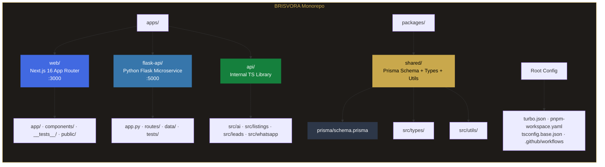

---

## 🚀 Getting Started

### Prerequisites

| Tool | Version | Install |
|---|---|---|
| Node.js | ≥ 18.0.0 | [nodejs.org](https://nodejs.org) |
| pnpm | ≥ 9.0.0 | `npm install -g pnpm@9` |
| Python | ≥ 3.11 | [python.org](https://python.org) |
| PostgreSQL | any | [Supabase](https://supabase.com) (recommended) |
| Git | any | [git-scm.com](https://git-scm.com) |

---

### Installation

```bash
# 1. Clone the repository
git clone https://github.com/DeadCoder-N/BRISVORA.git
cd BRISVORA

# 2. Install all dependencies (all workspaces)
pnpm install

# 3. Set up environment variables
cp apps/web/.env.example apps/web/.env.local

# 4. Install Python dependencies (Flask)
cd apps/flask-api
pip install -r requirements.txt
cd ../..

# 5. Generate Prisma client
pnpm db:generate

# 6. Run database migrations
pnpm db:migrate

# 7. Start both servers
pnpm dev        # Next.js on :3000
cd apps/flask-api && python app.py   # Flask on :5000
```

> **Next.js**: http://localhost:3000 · **Flask API**: http://localhost:5000

---

### Environment Variables

```env
# ─────────────────────────────────────────────
# REQUIRED — App will not start without these
# ─────────────────────────────────────────────
DATABASE_URL=postgresql://<user>:<password>@<host>:5432/postgres
AUTH_SECRET=<your_secret_here>
NEXTAUTH_URL=http://localhost:3000

# ─────────────────────────────────────────────
# WHATSAPP — AiSensy API
# ─────────────────────────────────────────────
AISENSY_API_KEY=<your_aisensy_campaign_api_key>
AISENSY_PHONE_NUMBER=<your_aisensy_whatsapp_number>

# ─────────────────────────────────────────────
# AI — Anthropic Claude 3.5 Sonnet (optional)
# ─────────────────────────────────────────────
ANTHROPIC_API_KEY=<your_anthropic_api_key>

# ─────────────────────────────────────────────
# IMAGES — Cloudinary (optional)
# ─────────────────────────────────────────────
CLOUDINARY_CLOUD_NAME=<your_cloud_name>
CLOUDINARY_API_KEY=<your_cloudinary_api_key>
CLOUDINARY_API_SECRET=<your_cloudinary_api_secret>

# ─────────────────────────────────────────────
# FLASK MOCK API URL (optional, for fallback)
# ─────────────────────────────────────────────
NEXT_PUBLIC_FLASK_API_URL=http://localhost:5000
```

---

### All Commands

```bash
# ── Development ──────────────────────────────
pnpm dev              # Next.js on port 3000
cd apps/flask-api && python app.py  # Flask on port 5000

# ── Testing ──────────────────────────────────
pnpm test:run         # 44 Vitest tests
cd apps/flask-api && pytest  # Flask tests

# ── Build ────────────────────────────────────
pnpm build            # Next.js production build

# ── Database ─────────────────────────────────
pnpm db:generate      # Regenerate Prisma client
pnpm db:migrate       # Run pending migrations
pnpm db:studio        # Prisma Studio at localhost:5555
```

---

## 🌐 All Pages

### Public Property Pages (NEW — SEO Optimized)

| Route | SEO Title Pattern | Template |
|---|---|---|
| `/apartment/[slug]` | "2 BHK Apartment in Mumbai" | 1BHK / 2BHK / 3BHK variants |
| `/villa/[slug]` | "4 BHK Luxury Villa in Pune" | Premium layout, gold accents |
| `/plot/[slug]` | "1200 sqft Plot in Bangalore" | Legal section, land-specific |
| `/commercial/[slug]` | "1800 sqft Office in Delhi" | Business suitability section |
| `/property/[slug]` | (legacy) | 301 redirects to correct type route |

### All Public Pages

| Page | URL |
|---|---|
| Homepage | `/` |
| Property (legacy redirect) | `/property/[slug]` → 301 |
| About | `/about` |
| Blog | `/blog` |
| Contact | `/contact` |
| Pricing | `/pricing` |
| Features | `/features` (×5 sub-pages) |
| Solutions | `/solutions` (×8 sub-pages) |
| Docs | `/docs` (×1 sub-page) |
| Guides | `/guides` |
| Help | `/help` |
| Roadmap | `/roadmap` |
| Changelog | `/changelog` |
| Security | `/security` |
| Privacy | `/privacy-policy` |
| Terms | `/terms` |
| Cookies | `/cookies` |
| Licenses | `/licenses` |
| Webhooks | `/webhooks` |
| SDKs | `/sdks` |

### Auth Pages

| Page | URL |
|---|---|
| Login | `/login` |
| Register | `/register` — includes country code dropdown (NEW) |

### Dashboard Pages (🔒 Auth required)

| Page | URL |
|---|---|
| Growth OS | `/dashboard/growth` |
| Listings | `/dashboard/listings` |
| New Listing | `/dashboard/listings/new` |
| Edit Listing | `/dashboard/listings/[id]/edit` |
| Leads | `/dashboard/leads` |
| Analytics | `/dashboard/analytics` |
| Activity | `/dashboard/activity` |
| Profile | `/dashboard/profile` |

### Admin Pages (🛡️ ADMIN + SUPER_ADMIN)

| Page | URL |
|---|---|
| Admin Panel | `/admin` |
| Users | `/admin/users` |
| Properties | `/admin/properties` |
| Leads | `/admin/leads` |
| Messages | `/admin/messages` |
| CMS (Super Admin only) | `/admin/cms` — NEW |

---

## 🔌 API Reference

### New Mock API Routes (Flask on Render.com)

| Method | Endpoint | Purpose |
|---|---|---|
| `GET` | `/api/mock/apartment/1bhk` | Mock 1 BHK apartment data |
| `GET` | `/api/mock/apartment/2bhk` | Mock 2 BHK apartment data |
| `GET` | `/api/mock/apartment/3bhk` | Mock 3 BHK apartment data |
| `GET` | `/api/mock/villa` | Mock luxury villa data |
| `GET` | `/api/mock/plot` | Mock residential plot data |
| `GET` | `/api/mock/commercial` | Mock commercial space data |
| `GET` | `/health` | Health check |

### Updated Public Routes

| Method | URL | Change |
|---|---|---|
| `POST` | `/api/leads` | Now accepts `countryCode` + `tokenCount` fields |
| `POST` | `/api/upload` | Now accepts video files (`resource_type: auto`) |

### Updated Broker Routes

| Method | URL | Change |
|---|---|---|
| `GET` | `/api/broker/listings` | Includes `mockDataUrl` + `mediaJson` in response |
| `GET` | `/api/broker/analytics` | Includes duplicate detection stats |

---

## 🗄️ Database Schema — Changes Reference

### Property (3 new additive fields)

```prisma
model Property {
  // ... existing fields unchanged
  
  mockDataUrl String?   // NEW: URL to Flask mock JSON for page fallback
  mediaJson   Json?     // NEW: [{ url, type: "image"|"video", caption, order }]
  plan        String?   // NEW: "starter" | "professional" | "business" | "enterprise"
  
  // ... existing relations unchanged
}
```

### Image (1 new field)

```prisma
model Image {
  // ... existing fields unchanged
  
  mediaType   String?   // NEW: "image" | "video" — Cloudinary auto-detects
}
```

### Lead (2 new additive fields)

```prisma
model Lead {
  // ... existing fields unchanged
  
  countryCode String?   // NEW: "+91" (India default), "+1", "+44", etc.
  tokenCount  Int?      // NEW: Character count of enquiry message (0-200)
  
  @@unique([propertyId, phone, createdAt]) // NEW: Duplicate prevention
}
```

### User (1 new field)

```prisma
model User {
  // ... existing fields unchanged
  
  plan String?   // NEW: "starter" | "professional" | "business" | "enterprise"
}
```

---

## Key Conventions (Updated)

| Rule | Detail |
|---|---|
| DB access | Always through `@brisvora/shared` — never import Prisma directly in `web` |
| Business logic | Always in `@brisvora/api` or Flask — route handlers are thin wrappers |
| Slugs | Auto-generated from property title + UUID prefix via `generateSlug()` |
| Phone numbers | Normalized with country code — e.g. `+919999999999` |
| Property URLs | Type-specific: `/apartment/[slug]`, `/villa/[slug]`, `/plot/[slug]`, `/commercial/[slug]` |
| Legacy redirect | `/property/[slug]` → 301 redirects to correct type route |
| Fallback chain (generation) | Claude 3.5 → Regex mock → Flask JSON mock API |
| Fallback chain (page render) | DB data → Flask mock → Hardcoded TS fallback |
| Styling | Inline styles + CSS custom properties — no Tailwind, no CSS modules |
| Charts | Pure SVG/CSS — no chart libraries |
| Animations | `prefers-reduced-motion` respected on every element |
| DB changes | ADDITIVE ONLY — never remove or rename existing fields |
| Duplicate detection | Properties: phone+city+price+BHK within 24hrs · Leads: propertyId+phone within 24hrs |
| Mock data | Flask serves JSON at `/api/mock/{type}/{bhk}`, URL stored in `Property.mockDataUrl` |
| CMS | Super Admin only — controls schemas, templates, global content |
| Country dropdown | Default India (+91) on both registration and LeadForm |
| Video | Optional media type via `Image.mediaType` — Cloudinary auto-detects |
| Flask deployment | Render.com (free tier) — Docker container, auto-deploy from GitHub |
| CI/CD | GitHub Actions → test both → deploy Vercel + Render in parallel |

---

## Architecture Decisions (Updated)

| Decision | Reason |
|---|---|
| Type-specific SEO routes (`/apartment/`, `/villa/`, etc.) | URL is free SEO — Google ranks "2 BHK Apartment in Mumbai" higher than "property/some-slug" |
| Flask microservice for mock data | Always-on JSON API provides Level 3 fallback when Claude + Regex both fail |
| Flask serves what DB will later serve | Same interface — swap Flask URL for real DB query with zero code change |
| 3-level fallback chain | Zero tolerance for blank pages — property pages ALWAYS render something |
| /property/[slug] → 301 redirect | Preserves existing backlinks while migrating to better SEO URL structure |
| Country code as separate field | Supports international buyers without breaking existing phone number format |
| Token counter on LeadForm | Gives buyer real-time feedback, helps broker prioritize quality leads |
| Duplicate detection at 2 levels | Prevents broker frustration (same property twice) AND buyer confusion (double enquiry) |
| CMS for Super Admin only | You control the templates — no one else can break the schema |
| Render.com for Flask (not Vercel) | ffmpeg support, unlimited timeout, file system access for future video transcoding |
| mediaJson instead of mediaType on Image | One JSON column stores all media metadata — zero migration for new types |
| Additive DB changes only | Never breaks existing production data — safe to deploy at any time |

---

# 📐 Architecture Diagrams

## System Architecture — Full Overview

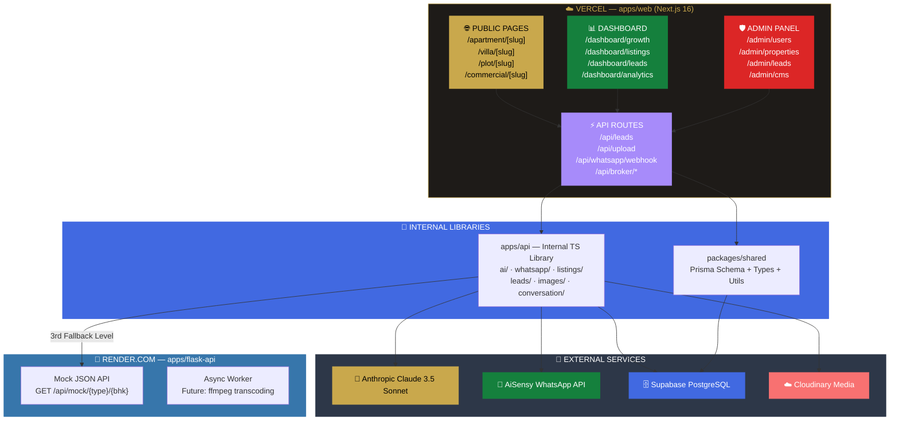

---

## Listing Generation Flow — 3-Level Fallback Chain

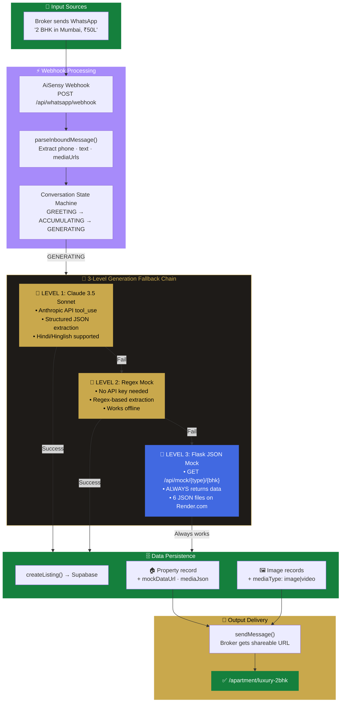

---

## Property Page Data Flow — 3-Level Rendering Fallback

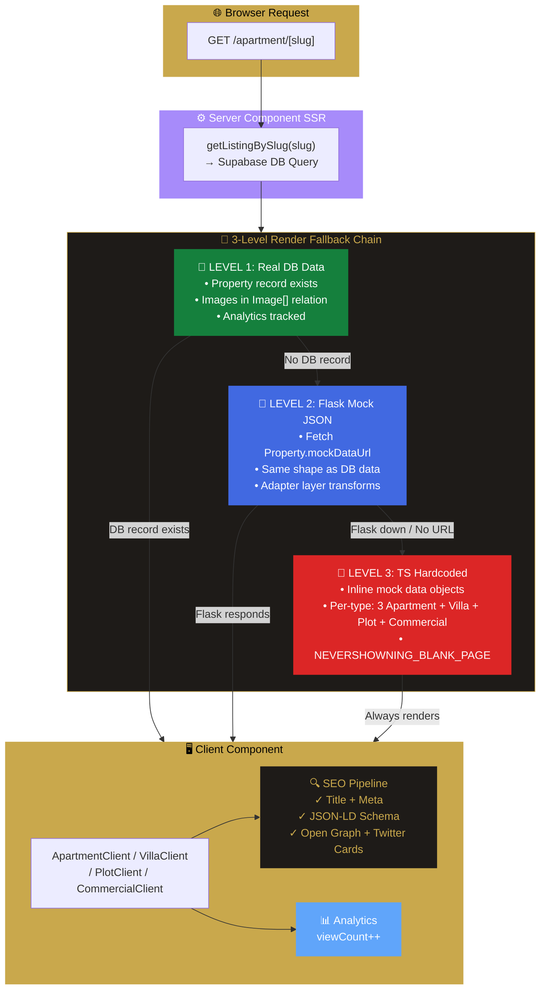

---

## SEO Route Structure — 4 Type-Specific Patterns

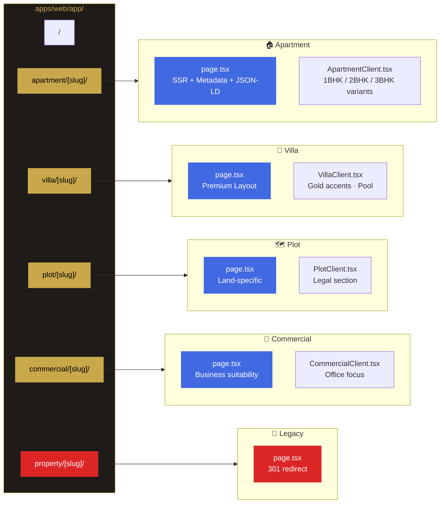

**Title & Description Pattern:**

| Route | Title | Description |
|---|---|---|
| `/apartment/[slug]` | 2 BHK Apartment in Bandra West, Mumbai | Browse this 2 BHK apartment... |
| `/villa/[slug]` | 4 BHK Luxury Villa in Koregaon Park, Pune | Premium villa for sale in Pune... |
| `/plot/[slug]` | 1200 sqft Plot in Whitefield, Bangalore | Residential plot for sale... |
| `/commercial/[slug]` | 1800 sqft Office in Connaught Place, Delhi | Commercial space for sale... |

---

## Flask Mock API — Python Microservice Architecture

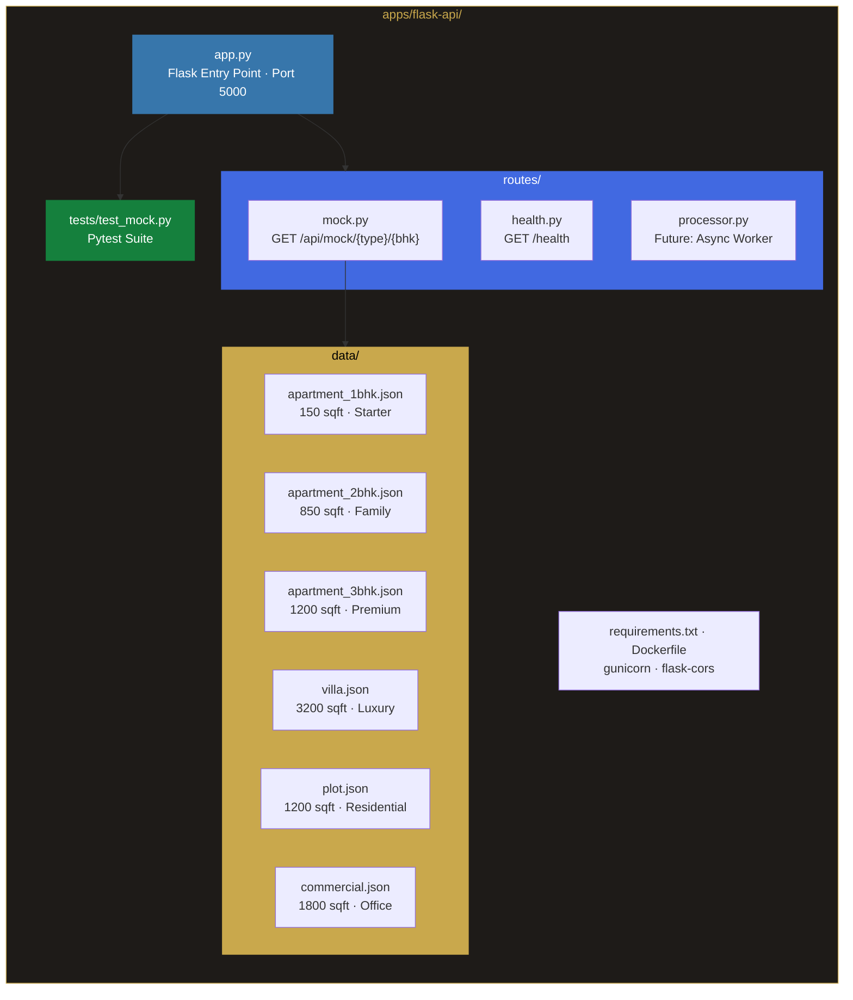

**API Endpoints:**

```
GET /api/mock/apartment/1bhk     → apartment_1bhk.json
GET /api/mock/apartment/2bhk     → apartment_2bhk.json
GET /api/mock/apartment/3bhk     → apartment_3bhk.json
GET /api/mock/villa              → villa.json
GET /api/mock/plot               → plot.json
GET /api/mock/commercial         → commercial.json
GET /health                      → { status: "ok", version: "1.0.0" }
```

**Each mock JSON contains:**
```json
{
  "title": "2 BHK Apartment in Bandra West, Mumbai",
  "description": "...",
  "price": 12000000,
  "priceLabel": "₹1.2 Cr",
  "bedrooms": 2,
  "bathrooms": 2,
  "areaSqft": 850,
  "city": "Mumbai",
  "address": "Bandra West, Mumbai",
  "type": "APARTMENT",
  "features": ["Modular Kitchen", "Vitrified Tiles", "False Ceiling", ...],
  "amenities": ["Swimming Pool", "Gym", "Security", "Garden", ...],
  "images": [
    { "url": "https://placehold.co/800x600/1e1b18/C9A84C", "caption": "Living Room", "type": "image" }
  ],
  "broker": { "name": "Rahul Sharma", "phone": "918850908790", "agency": "Brisvora Realty" },
  "location": { "lat": 19.0596, "lng": 72.8295 }
}
```

---

## Database Schema — Entity Relationship Diagram

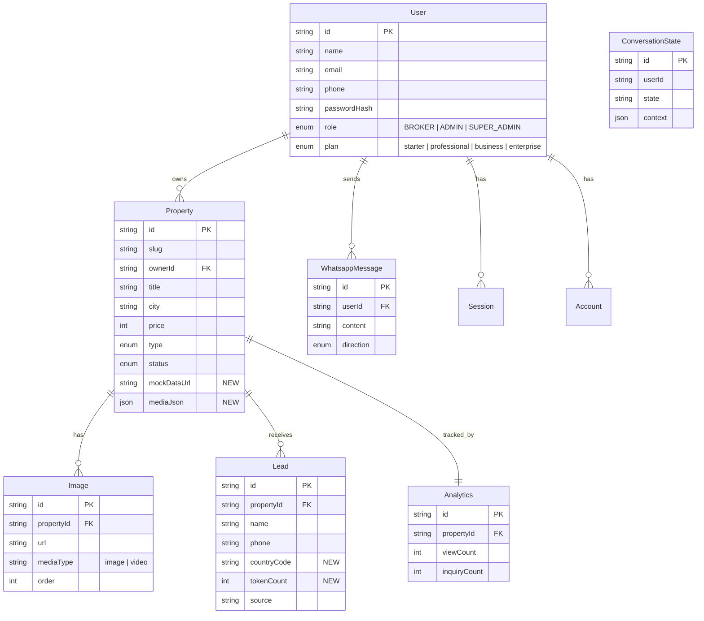

**Additive DB Changes Summary:**

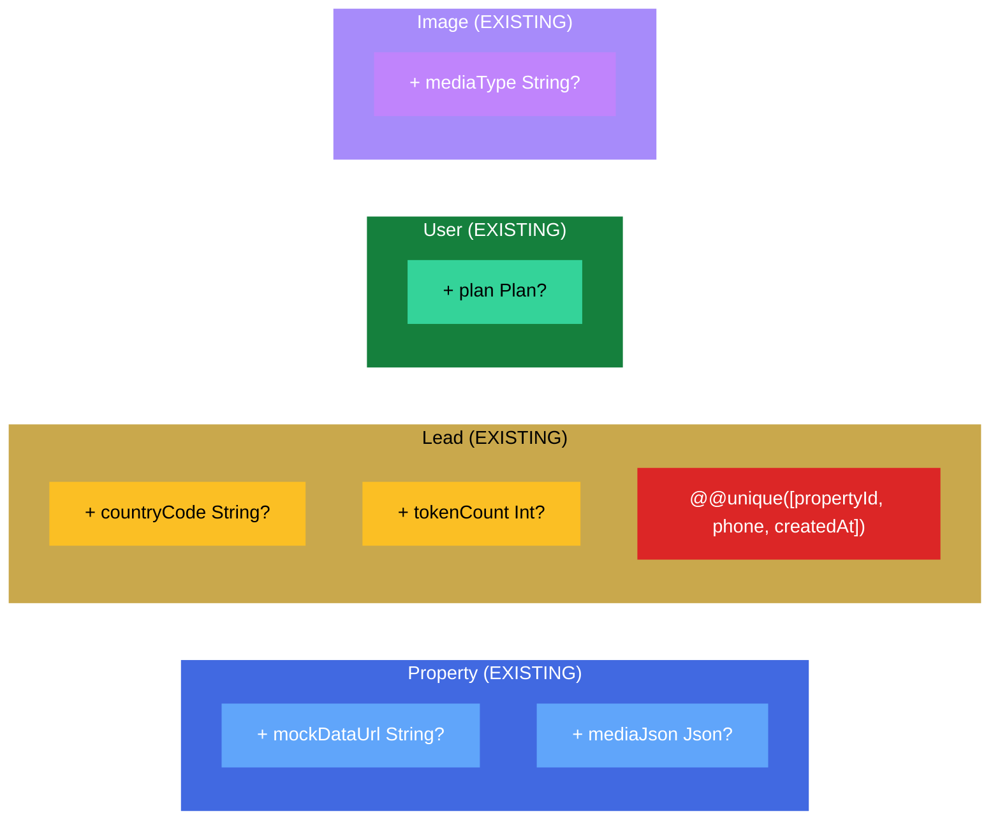

---

## CI/CD Pipeline — GitHub Actions

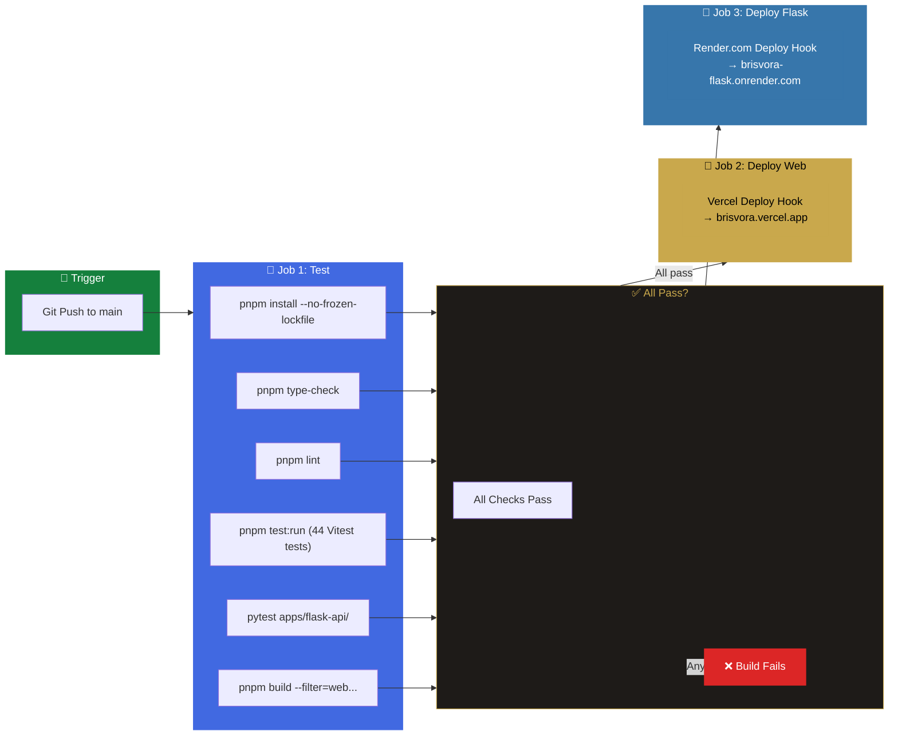

---

## CMS Layer — Super Admin Only

```mermaid
flowchart LR
    subgraph CMS["🛡️ CMS CONTROL PANEL (Super Admin Only)"]
        direction TB
        
        SCHEMAS["📋 PROPERTY TYPE SCHEMAS"]
        TEMPLATES["🎨 TEMPLATE LAYOUTS"]
        GLOBAL["🌍 GLOBAL CONTENT"]
        MOCK_CTRL["📁 MOCK DATA MANAGEMENT"]
        
        subgraph SCHEMAS_DETAIL[" "]
            APT_SCHEMA["Apartment: title, price, BHK,<br/>area, floor, parking"]
            VILLA_SCHEMA["Villa: title, price, BHK,<br/>pool, garden, floors"]
            PLOT_SCHEMA["Plot: title, price, area,<br/>zone, dimensions"]
            COMM_SCHEMA["Commercial: title, price,<br/>area, floor, parking, power"]
        end
        
        subgraph TEMPLATES_DETAIL[" "]
            APT_TEMP["Apartment: hero + specs + features"]
            VILLA_TEMP["Villa: taller hero + premium specs"]
            PLOT_TEMP["Plot: hero + legal + land info"]
            COMM_TEMP["Commercial: hero + business suitability"]
            EDITOR["Section order editor (drag & drop)"]
        end
        
        subgraph GLOBAL_DETAIL[" "]
            LABELS["Section labels / text"]
            CTA["CTA button copies"]
            FEATURES["Feature descriptions"]
            DEFAULT_PHONE["Default country code"]
        end
        
        subgraph MOCK_DETAIL[" "]
            EDIT_JSON["Edit mock JSON inline"]
            PREVIEW["Preview mock rendering"]
            DEPLOY["Deploy changes to Flask"]
            HISTORY["Version history"]
        end
    end

    CMS --> STORAGE["🗄️ Stored in Supabase CMS table"]
    STORAGE --> PROPAGATE["⚡ Changes propagate to<br/>all new listings automatically"]

    style CMS fill:#1e1b18,color:#C9A84C,stroke:#C9A84C
    style SCHEMAS fill:#a78bfa,color:#fff,stroke:#a78bfa
    style TEMPLATES fill:#C9A84C,color:#000,stroke:#C9A84C
    style GLOBAL fill:#15803D,color:#fff,stroke:#15803D
    style MOCK_CTRL fill:#4169E1,color:#fff,stroke:#4169E1
    style SCHEMAS_DETAIL fill:#2D3748,color:#fff,stroke:#2D3748
    style TEMPLATES_DETAIL fill:#2D3748,color:#fff,stroke:#2D3748
    style GLOBAL_DETAIL fill:#2D3748,color:#fff,stroke:#2D3748
    style MOCK_DETAIL fill:#2D3748,color:#fff,stroke:#2D3748
    style STORAGE fill:#DC2626,color:#fff,stroke:#DC2626
    style PROPAGATE fill:#15803D,color:#fff,stroke:#15803D
```

---

## Role Hierarchy & Plan Mapping

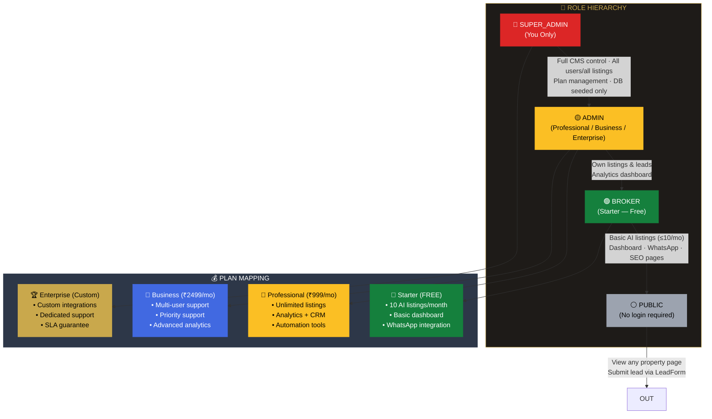

---

## Duplicate Entry Sanitization Flow

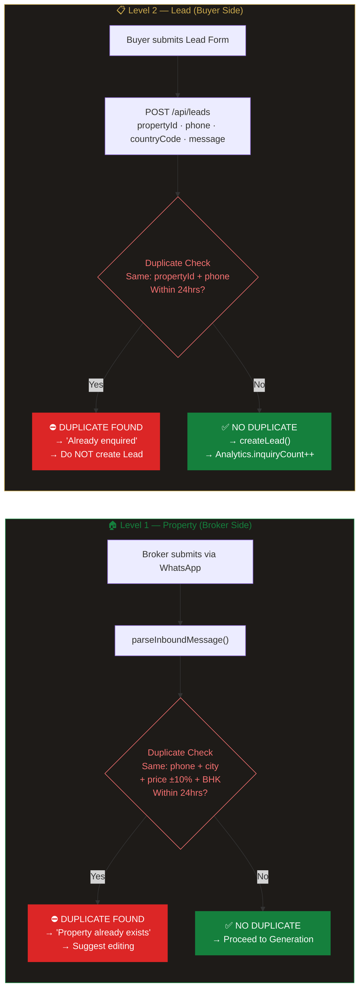

---

## Country Dropdown — Registration & LeadForm

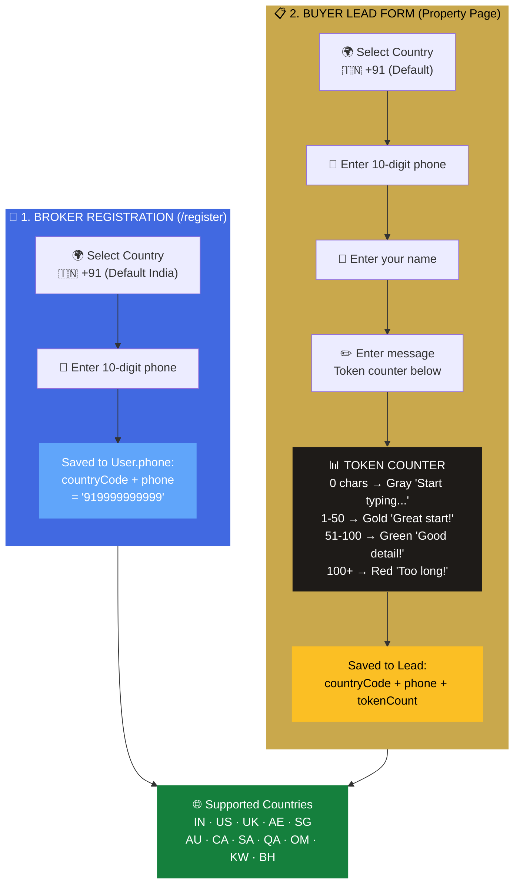

---

## Video Support — Optional Media on Property Page

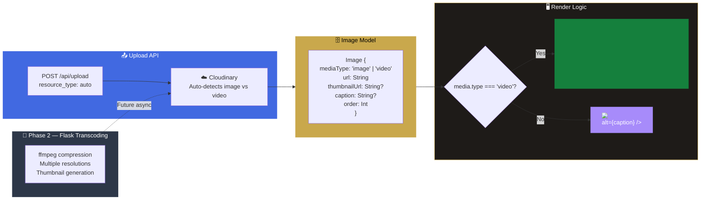

---

## Master Reactive System Architecture — Event Propagation & State Update Flow

This diagram shows the **complete reactive interaction** across the entire platform — how every event triggers cascading state updates, how components react to changes in real-time, and how the system maintains perfect consistency across all layers.

```mermaid
flowchart TB
    %% ─── EVENT ORIGINS ───────────────────────────────────────────────────
    subgraph EVENT_SOURCES["🌐 EVENT SOURCES (Triggers)"]
        direction TB
        E1("📱 Broker WhatsApp<br/>'2 BHK in Mumbai, ₹50L'")
        E2("👤 Buyer Lead Form<br/>'Interested in this property'")
        E3("🗺️ Buyer Page Visit<br/>GET /apartment/luxury-2bhk")
        E4("🔐 User Registration<br/>+91 9999999999")
        E5("⚙️ Admin Action<br/>Update/Delete/Override")
    end

    %% ─── EVENT PROCESSING LAYER (Vercel) ─────────────────────────────────
    subgraph EVENT_PROC["⚡ EVENT PROCESSING (Vercel — Next.js 16)"]
        direction TB
        WH["Webhook Handler<br/>POST /api/whatsapp/webhook"]
        LH["Lead Handler<br/>POST /api/leads"]
        PH["Page Handler<br/>Server Component SSR"]
        RH["Register Handler<br/>POST /api/register"]
        UH["Upload Handler<br/>POST /api/upload"]
        AH["Admin Handler<br/>PUT /api/admin/*"]
    end

    E1 --> WH
    E2 --> LH
    E3 --> PH
    E4 --> RH
    E5 --> AH

    %% ─── BUSINESS LOGIC LAYER (apps/api) ──────────────────────────────────
    subgraph BUS_LOGIC["🧠 BUSINESS LOGIC (apps/api — Internal TS Library)"]
        direction TB
        AI_FALLBACK["🤖 3-Level Fallback Chain<br/>Claude 3.5 → Regex → Flask"]
        DUPE_PROP["🔍 Property Dup Detection<br/>phone+city+price+BHK ≤ 24hrs"]
        DUPE_LEAD["🔍 Lead Dup Detection<br/>propertyId+phone ≤ 24hrs"]
        DUPE_USER["🔍 User Dup Detection<br/>email/phone already exists"]
        OTP_FLOW["🔐 OTP Flow<br/>send → verify → phoneVerified"]
        CONV_STATE["💭 Conversation State Machine<br/>GREETING → ACCUMULATING → GENERATING"]
        MEDIA_PROC["🖼️ Media Processing<br/>Cloudinary Upload → mediaJson"]
        ANALYTICS["📊 Analytics Pipeline<br/>viewCount++ → inquiryCount++"]
    end

    WH --> CONV_STATE
    CONV_STATE -->|GENERATING| AI_FALLBACK
    WH --> DUPE_PROP
    DUPE_PROP -->|Pass| AI_FALLBACK
    DUPE_PROP -->|Block: Already exists| BROKER_BLOCK(["⛔ Reply: Property exists"])
    
    LH --> DUPE_LEAD
    DUPE_LEAD -->|Pass| LEADS["📋 Lead Sanitization<br/>tokenCount · countryCode"]
    DUPE_LEAD -->|Block: Already enquired| BUYER_BLOCK(["⛔ Return: Already enquired"])

    RH --> DUPE_USER
    DUPE_USER -->|Pass| OTP_FLOW
    DUPE_USER -->|Block: 409 Conflict| REG_BLOCK(["⛔ 409: Email/phone in use"])

    PH --> ANALYTICS
    PH --> RENDER_FALLBACK["📄 3-Level Render Fallback<br/>DB → Flask Mock → TS Hardcoded"]

    E5 --> AH

    %% ─── DATA PERSISTENCE LAYER ──────────────────────────────────────────
    subgraph DATA_PERSIST["🗄️ DATA PERSISTENCE (packages/shared + Supabase)"]
        direction TB
        DB_PROPERTY["🏠 Property<br/>+ slug · mockDataUrl · mediaJson · plan"]
        DB_USER["👤 User<br/>+ phone · countryCode · phoneVerified · role · plan"]
        DB_LEAD["📋 Lead<br/>+ propertyId · phone · countryCode · tokenCount"]
        DB_IMAGE["🖼️ Image<br/>+ url · mediaType: image|video · order"]
        DB_ANALYTICS["📊 Analytics<br/>+ viewCount · inquiryCount"]
        DB_OTP["🔐 OtpVerification<br/>+ otp · expiresAt · attempts · verified"]
        DB_CONV["💭 ConversationState<br/>+ state · context"]
        DB_MSG["💬 WhatsappMessage<br/>+ content · direction"]
    end

    AI_FALLBACK -->|createListing| DB_PROPERTY
    AI_FALLBACK --> DB_IMAGE
    DUPE_PROP --> DB_PROPERTY
    LEADS --> DB_LEAD
    DUPE_LEAD --> DB_LEAD
    ANALYTICS --> DB_ANALYTICS
    OTP_FLOW --> DB_OTP
    OTP_FLOW -->|phoneVerified=true| DB_USER
    DUPE_USER --> DB_USER
    CONV_STATE --> DB_CONV
    CONV_STATE --> DB_MSG
    MEDIA_PROC --> DB_IMAGE
    MEDIA_PROC --> DB_PROPERTY
    AH --> DB_PROPERTY
    AH --> DB_USER
    AH --> DB_LEAD

    %% ─── REACTIVE UI LAYER (Continuously Re-renders) ──────────────────────
    subgraph REACTIVE_UI["🔄 REACTIVE UI (apps/web — Dashboard Components)"]
        direction TB
        UI_GROWTH["📈 Growth OS<br/>Pending tasks · AI credits<br/>Quick actions · Activity feed"]
        UI_LISTINGS["🏠 Listings Panel<br/>Real-time property list<br/>Status · Views · Enquiries"]
        UI_LEADS["👥 Leads Panel<br/>Enquiry stream<br/>Source · Token count · Time"]
        UI_ANALYTICS["📊 Analytics Dashboard<br/>Views chart · Inquiries chart<br/>Conversion rate"]
        UI_PROFILE["👤 Profile Page<br/>Phone · Country code<br/>Verify OTP button"]
        UI_ACTIVITY["📜 Activity Log<br/>Webhook events · Errors<br/>State transitions"]
    end

    DB_PROPERTY -->|useSWR revalidation| UI_LISTINGS
    DB_PROPERTY --> UI_GROWTH
    DB_LEAD -->|useSWR revalidation| UI_LEADS
    DB_LEAD --> UI_ANALYTICS
    DB_ANALYTICS --> UI_ANALYTICS
    DB_ANALYTICS --> UI_LISTINGS
    DB_USER --> UI_PROFILE
    DB_USER --> UI_GROWTH
    DB_CONV --> UI_ACTIVITY
    DB_MSG --> UI_ACTIVITY

    %% ─── EXTERNAL SERVICE REACTIONS ──────────────────────────────────────
    subgraph EXT_REACT["🔗 EXTERNAL SERVICE REACTIONS"]
        direction TB
        SEND_WA["📱 AiSensy Send<br/>OTP · Listing URL · Reply"]
        WEBHOOK_WA["📱 AiSensy Webhook<br/>Inbound message → Event"]
        CLOUD_UPLOAD["☁️ Cloudinary Upload<br/>Image · Video · Auto-detect"]
        ANTHROPIC_API["🧠 Anthropic API<br/>Claude 3.5 Sonnet"]
        FLASK_MOCK["🐍 Flask Mock API<br/>GET /api/mock/{type}/{bhk}"]
        SEO_PIPELINE["🔍 SEO Pipeline<br/>JSON-LD · OG · Twitter Cards"]
        REDIRECT_301["🔄 Legacy Redirect<br/>property/[slug] → 301 → type route"]
    end

    OTP_FLOW --> SEND_WA
    AI_FALLBACK --> SEND_WA
    AI_FALLBACK -->|Level 1| ANTHROPIC_API
    AI_FALLBACK -->|Level 3| FLASK_MOCK
    PH --> SEO_PIPELINE
    PH --> REDIRECT_301
    SEND_WA -->|OTP delivered| UI_PROFILE
    SEND_WA -->|URL shared| UI_LISTINGS

    %% ─── REACTIVE CASCADE LABELS ─────────────────────────────────────────
    CASCADE1("⚡ REACTIVE CASCADE 1<br/>WhatsApp → Webhook → Conversation →<br/>Fallback → DB → UI → WhatsApp Reply")
    CASCADE2("⚡ REACTIVE CASCADE 2<br/>Page Visit → SSR → DB/Fallback →<br/>Render → Analytics++ → SEO Pipeline")
    CASCADE3("⚡ REACTIVE CASCADE 3<br/>Lead Form → Dup Check → Lead DB →<br/>Analytics++ → Broker Dashboard UI")
    CASCADE4("⚡ REACTIVE CASCADE 4<br/>Registration → Dup Check → OTP →<br/>Phone Verify → Dashboard Unlock")

    CASCADE1 -.->|"Chain 1"| WH
    CASCADE2 -.->|"Chain 2"| PH
    CASCADE3 -.->|"Chain 3"| LH
    CASCADE4 -.->|"Chain 4"| RH

    %% ─── STYLES ──────────────────────────────────────────────────────────
    style EVENT_SOURCES fill:#1e1b18,color:#C9A84C,stroke:#C9A84C
    style EVENT_PROC fill:#1e1b18,color:#a78bfa,stroke:#a78bfa
    style BUS_LOGIC fill:#1e1b18,color:#60a5fa,stroke:#60a5fa
    style DATA_PERSIST fill:#1e1b18,color:#15803D,stroke:#15803D
    style REACTIVE_UI fill:#1e1b18,color:#C9A84C,stroke:#C9A84C
    style EXT_REACT fill:#1e1b18,color:#f87171,stroke:#f87171
    
    style E1 fill:#15803D,color:#fff,stroke:#15803D
    style E2 fill:#C9A84C,color:#000,stroke:#C9A84C
    style E3 fill:#C9A84C,color:#000,stroke:#C9A84C
    style E4 fill:#60a5fa,color:#fff,stroke:#60a5fa
    style E5 fill:#f87171,color:#fff,stroke:#f87171
    
    style WH fill:#a78bfa,color:#fff,stroke:#a78bfa
    style LH fill:#a78bfa,color:#fff,stroke:#a78bfa
    style PH fill:#a78bfa,color:#fff,stroke:#a78bfa
    style RH fill:#a78bfa,color:#fff,stroke:#a78bfa
    style UH fill:#a78bfa,color:#fff,stroke:#a78bfa
    style AH fill:#a78bfa,color:#fff,stroke:#a78bfa
    
    style AI_FALLBACK fill:#C9A84C,color:#000,stroke:#C9A84C
    style DUPE_PROP fill:#f87171,color:#fff,stroke:#f87171
    style DUPE_LEAD fill:#f87171,color:#fff,stroke:#f87171
    style DUPE_USER fill:#f87171,color:#fff,stroke:#f87171
    style CONV_STATE fill:#60a5fa,color:#fff,stroke:#60a5fa
    style OTP_FLOW fill:#60a5fa,color:#fff,stroke:#60a5fa
    style ANALYTICS fill:#34d399,color:#000,stroke:#34d399
    
    style CASCADE1 fill:#15803D,color:#fff,stroke:#15803D
    style CASCADE2 fill:#15803D,color:#fff,stroke:#15803D
    style CASCADE3 fill:#15803D,color:#fff,stroke:#15803D
    style CASCADE4 fill:#15803D,color:#fff,stroke:#15803D
    
    style SEND_WA fill:#15803D,color:#fff,stroke:#15803D
    style WEBHOOK_WA fill:#15803D,color:#fff,stroke:#15803D
    style FLASK_MOCK fill:#4169E1,color:#fff,stroke:#4169E1
    style ANTHROPIC_API fill:#C9A84C,color:#000,stroke:#C9A84C
    style CLOUD_UPLOAD fill:#f87171,color:#fff,stroke:#f87171
    style SEO_PIPELINE fill:#C9A84C,color:#000,stroke:#C9A84C
    style REDIRECT_301 fill:#DC2626,color:#fff,stroke:#DC2626
    
    style UI_GROWTH fill:#C9A84C,color:#000,stroke:#C9A84C
    style UI_LISTINGS fill:#C9A84C,color:#000,stroke:#C9A84C
    style UI_LEADS fill:#C9A84C,color:#000,stroke:#C9A84C
    style UI_ANALYTICS fill:#C9A84C,color:#000,stroke:#C9A84C
    style UI_PROFILE fill:#C9A84C,color:#000,stroke:#C9A84C
    style UI_ACTIVITY fill:#C9A84C,color:#000,stroke:#C9A84C
    
    style BROKER_BLOCK fill:#DC2626,color:#fff,stroke:#DC2626
    style BUYER_BLOCK fill:#DC2626,color:#fff,stroke:#DC2626
    style REG_BLOCK fill:#DC2626,color:#fff,stroke:#DC2626
```

---

## Async Webhook Processing Architecture (Future)

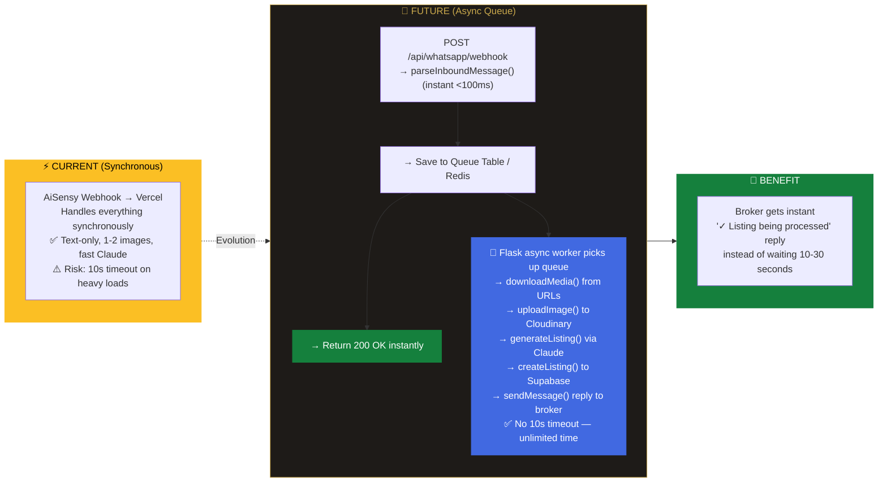

---

## 🧪 Testing

```bash
# 44 Vitest tests + Pytest suite
pnpm test:run
cd apps/flask-api && pytest
```

| Test Suite | Type | Count | What it tests |
|---|---|---|---|
| `api.edge-cases.test.ts` | Vitest | ✓ | API fallback chain, rate limiting, timeout handling |
| `dashboard.edge-cases.test.ts` | Vitest | ✓ | Dashboard rendering, empty states, error boundaries |
| Flask `test_mock.py` | Pytest | ✓ | Mock API endpoints, JSON validation, health check |

---

## 📝 License

Private — All Rights Reserved. © 2025 Brisvora