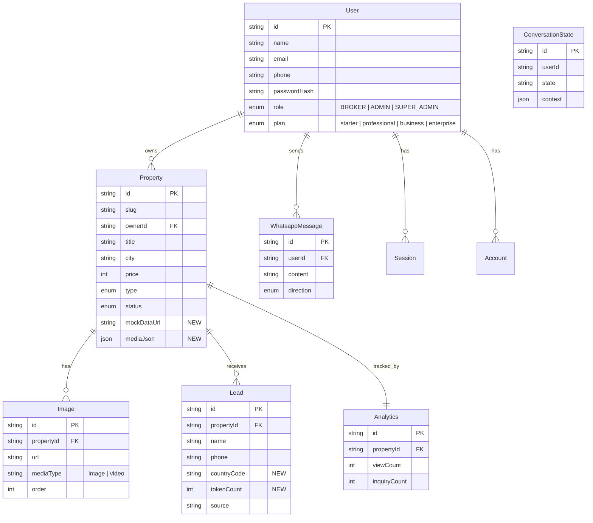
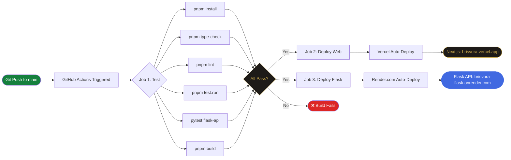
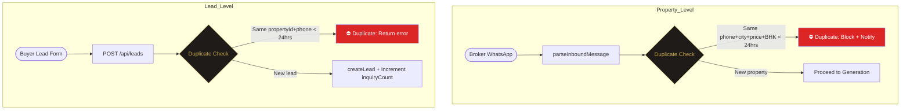

<div align="center">


# Brisvora

### AI-Powered Growth OS for Indian Real Estate Brokers

**"One Message. Unlimited Growth."**

[](https://brisvora.vercel.app)
[](https://nextjs.org)
[](https://typescriptlang.org)
[](https://flask.palletsprojects.com)
[](https://supabase.com)
[](#testing)
[](#license)

</div>

---

🛠️ Tech Stack

| Layer | Technology | Version |
|---|---|---|
| Framework | [Next.js](https://nextjs.org) App Router | 16.2.9 |
| UI Library | [React](https://react.dev) | 19.2.4 |
| Language | [TypeScript](https://typescriptlang.org) | 5.x |
| Microservice | [Python Flask](https://flask.palletsprojects.com) | 3.x |
| Styling | Inline styles + CSS custom properties | — |
| Typography | Playfair Display · Cinzel · DM Sans | Google Fonts |
| Auth | [NextAuth](https://authjs.dev) v5 beta + Prisma adapter | 5.0.0-beta.31 |
| Database | [PostgreSQL](https://supabase.com) via Supabase | — |
| ORM | [Prisma](https://prisma.io) | latest |
| AI | [Claude 3.5 Sonnet](https://anthropic.com) — regex mock fallback | Anthropic SDK |
| WhatsApp | [AiSensy](https://aisensy.com) API (webhook + send) | — |
| Images + Video | [Cloudinary](https://cloudinary.com) — optional, fallback exists | — |
| Testing | [Vitest](https://vitest.dev) + [MSW](https://mswjs.io) + [Pytest](https://pytest.org) | 4.x + 2.x + latest |
| Monorepo | [pnpm](https://pnpm.io) 9 + [Turborepo](https://turbo.build) | 9.15.0 + 2.x |
| Deployment Web | [Vercel](https://vercel.com) | — |
| Deployment API | [Render.com](https://render.com) (Flask) | — |
| CI/CD | [GitHub Actions](https://github.com/features/actions) | — |

---

## 📁 Monorepo Structure

```
BRISVORA/
├── apps/
│   ├── web/                          # Next.js 16 — main server (port 3000)
│   │   ├── app/
│   │   │   ├── apartment/[slug]/     # NEW: 1/2/3 BHK type-specific SEO routes
│   │   │   ├── villa/[slug]/         # NEW: Luxury villa pages
│   │   │   ├── plot/[slug]/          # NEW: Land/plot pages
│   │   │   ├── commercial/[slug]/    # NEW: Commercial property pages
│   │   │   ├── property/[slug]/      # OLD: 301 redirects to type route
│   │   │   ├── (auth)/
│   │   │   ├── dashboard/            # Growth, listings, leads, analytics
│   │   │   ├── admin/                # Role-gated admin panel
│   │   │   ├── api/                  # All route handlers
│   │   │   │   ├── mock/[type]/      # NEW: Flask mock API proxy fallback
│   │   │   │   └── ...
│   │   │   └── globals.css           # Design token system
│   │   ├── components/               # React components
│   │   └── __tests__/                # 44 Vitest tests
│   │
│   ├── flask-api/                    # NEW: Python Flask microservice
│   │   ├── app.py                    # Flask entry point
│   │   ├── routes/
│   │   │   ├── mock.py              # GET /api/mock/{type}/{bhk}
│   │   │   └── health.py            # GET /health
│   │   ├── data/                     # Mock JSON files (6 total)
│   │   ├── requirements.txt
│   │   └── Dockerfile
│   │
│   └── api/                          # Internal TS library
│       └── src/
│           ├── ai/index.ts           # 3-level fallback chain
│           ├── listings/index.ts      # Duplicate detection
│           ├── leads/index.ts        # Lead sanitization
│           └── ...
│
├── packages/
│   └── shared/
│       ├── prisma/schema.prisma      # mockDataUrl, mediaJson, countryCode, plan
│       └── src/
│           ├── types/index.ts        # All TypeScript interfaces
│           └── utils/index.ts
│
├── .github/
│   └── workflows/
│       └── deploy.yml                # NEW: CI/CD — test → Vercel + Render
│
├── turbo.json
├── pnpm-workspace.yaml
└── README.md
```

---

## 🚀 Getting Started

### Prerequisites

| Tool | Version | Install |
|---|---|---|
| Node.js | ≥ 18.0.0 | [nodejs.org](https://nodejs.org) |
| pnpm | ≥ 9.0.0 | `npm install -g pnpm@9` |
| Python | ≥ 3.11 | [python.org](https://python.org) |
| PostgreSQL | any | [Supabase](https://supabase.com) (recommended) |
| Git | any | [git-scm.com](https://git-scm.com) |

---

### Installation

```bash
# 1. Clone the repository
git clone https://github.com/DeadCoder-N/BRISVORA.git
cd BRISVORA

# 2. Install all dependencies (all workspaces)
pnpm install

# 3. Set up environment variables
cp apps/web/.env.example apps/web/.env.local

# 4. Install Python dependencies (Flask)
cd apps/flask-api
pip install -r requirements.txt
cd ../..

# 5. Generate Prisma client
pnpm db:generate

# 6. Run database migrations
pnpm db:migrate

# 7. Start both servers
pnpm dev        # Next.js on :3000
cd apps/flask-api && python app.py   # Flask on :5000
```

> **Next.js**: http://localhost:3000 · **Flask API**: http://localhost:5000

---

### Environment Variables

```env
# ─────────────────────────────────────────────
# REQUIRED — App will not start without these
# ─────────────────────────────────────────────
DATABASE_URL=postgresql://<user>:<password>@<host>:5432/postgres
AUTH_SECRET=<your_secret_here>
NEXTAUTH_URL=http://localhost:3000

# ─────────────────────────────────────────────
# WHATSAPP — AiSensy API
# ─────────────────────────────────────────────
AISENSY_API_KEY=<your_aisensy_campaign_api_key>
AISENSY_PHONE_NUMBER=<your_aisensy_whatsapp_number>

# ─────────────────────────────────────────────
# AI — Anthropic Claude 3.5 Sonnet (optional)
# ─────────────────────────────────────────────
ANTHROPIC_API_KEY=<your_anthropic_api_key>

# ─────────────────────────────────────────────
# IMAGES — Cloudinary (optional)
# ─────────────────────────────────────────────
CLOUDINARY_CLOUD_NAME=<your_cloud_name>
CLOUDINARY_API_KEY=<your_cloudinary_api_key>
CLOUDINARY_API_SECRET=<your_cloudinary_api_secret>

# ─────────────────────────────────────────────
# FLASK MOCK API URL (optional, for fallback)
# ─────────────────────────────────────────────
NEXT_PUBLIC_FLASK_API_URL=http://localhost:5000
```

---

### All Commands

```bash
# ── Development ──────────────────────────────
pnpm dev              # Next.js on port 3000
cd apps/flask-api && python app.py  # Flask on port 5000

# ── Testing ──────────────────────────────────
pnpm test:run         # 44 Vitest tests
cd apps/flask-api && pytest  # Flask tests

# ── Build ────────────────────────────────────
pnpm build            # Next.js production build

# ── Database ─────────────────────────────────
pnpm db:generate      # Regenerate Prisma client
pnpm db:migrate       # Run pending migrations
pnpm db:studio        # Prisma Studio at localhost:5555
```

---

## 🌐 All Pages

### Public Property Pages (NEW — SEO Optimized)

| Route | SEO Title Pattern | Template |
|---|---|---|
| `/apartment/[slug]` | "2 BHK Apartment in Mumbai" | 1BHK / 2BHK / 3BHK variants |
| `/villa/[slug]` | "4 BHK Luxury Villa in Pune" | Premium layout, gold accents |
| `/plot/[slug]` | "1200 sqft Plot in Bangalore" | Legal section, land-specific |
| `/commercial/[slug]` | "1800 sqft Office in Delhi" | Business suitability section |
| `/property/[slug]` | (legacy) | 301 redirects to correct type route |

### All Public Pages

| Page | URL |
|---|---|
| Homepage | `/` |
| Property (legacy redirect) | `/property/[slug]` → 301 |
| About | `/about` |
| Blog | `/blog` |
| Contact | `/contact` |
| Pricing | `/pricing` |
| Features | `/features` (×5 sub-pages) |
| Solutions | `/solutions` (×8 sub-pages) |
| Docs | `/docs` (×1 sub-page) |
| Guides | `/guides` |
| Help | `/help` |
| Roadmap | `/roadmap` |
| Changelog | `/changelog` |
| Security | `/security` |
| Privacy | `/privacy-policy` |
| Terms | `/terms` |
| Cookies | `/cookies` |
| Licenses | `/licenses` |
| Webhooks | `/webhooks` |
| SDKs | `/sdks` |

### Auth Pages

| Page | URL |
|---|---|
| Login | `/login` |
| Register | `/register` — includes country code dropdown (NEW) |

### Dashboard Pages (🔒 Auth required)

| Page | URL |
|---|---|
| Growth OS | `/dashboard/growth` |
| Listings | `/dashboard/listings` |
| New Listing | `/dashboard/listings/new` |
| Edit Listing | `/dashboard/listings/[id]/edit` |
| Leads | `/dashboard/leads` |
| Analytics | `/dashboard/analytics` |
| Activity | `/dashboard/activity` |
| Profile | `/dashboard/profile` |

### Admin Pages (🛡️ ADMIN + SUPER_ADMIN)

| Page | URL |
|---|---|
| Admin Panel | `/admin` |
| Users | `/admin/users` |
| Properties | `/admin/properties` |
| Leads | `/admin/leads` |
| Messages | `/admin/messages` |
| CMS (Super Admin only) | `/admin/cms` — NEW |

---

## 🔌 API Reference

### New Mock API Routes (Flask on Render.com)

| Method | Endpoint | Purpose |
|---|---|---|
| `GET` | `/api/mock/apartment/1bhk` | Mock 1 BHK apartment data |
| `GET` | `/api/mock/apartment/2bhk` | Mock 2 BHK apartment data |
| `GET` | `/api/mock/apartment/3bhk` | Mock 3 BHK apartment data |
| `GET` | `/api/mock/villa` | Mock luxury villa data |
| `GET` | `/api/mock/plot` | Mock residential plot data |
| `GET` | `/api/mock/commercial` | Mock commercial space data |
| `GET` | `/health` | Health check |

### Updated Public Routes

| Method | URL | Change |
|---|---|---|
| `POST` | `/api/leads` | Now accepts `countryCode` + `tokenCount` fields |
| `POST` | `/api/upload` | Now accepts video files (`resource_type: auto`) |

### Updated Broker Routes

| Method | URL | Change |
|---|---|---|
| `GET` | `/api/broker/listings` | Includes `mockDataUrl` + `mediaJson` in response |
| `GET` | `/api/broker/analytics` | Includes duplicate detection stats |

---

## 🗄️ Database Schema — Changes Reference

### Property (3 new additive fields)

```prisma
model Property {
  // ... existing fields unchanged
  
  mockDataUrl String?   // NEW: URL to Flask mock JSON for page fallback
  mediaJson   Json?     // NEW: [{ url, type: "image"|"video", caption, order }]
  plan        String?   // NEW: "starter" | "professional" | "business" | "enterprise"
  
  // ... existing relations unchanged
}
```

### Image (1 new field)

```prisma
model Image {
  // ... existing fields unchanged
  
  mediaType   String?   // NEW: "image" | "video" — Cloudinary auto-detects
}
```

### Lead (2 new additive fields)

```prisma
model Lead {
  // ... existing fields unchanged
  
  countryCode String?   // NEW: "+91" (India default), "+1", "+44", etc.
  tokenCount  Int?      // NEW: Character count of enquiry message (0-200)
  
  @@unique([propertyId, phone, createdAt]) // NEW: Duplicate prevention
}
```

### User (1 new field)

```prisma
model User {
  // ... existing fields unchanged
  
  plan String?   // NEW: "starter" | "professional" | "business" | "enterprise"
}
```

---

## Key Conventions (Updated)

| Rule | Detail |
|---|---|
| DB access | Always through `@brisvora/shared` — never import Prisma directly in `web` |
| Business logic | Always in `@brisvora/api` or Flask — route handlers are thin wrappers |
| Slugs | Auto-generated from property title + UUID prefix via `generateSlug()` |
| Phone numbers | Normalized with country code — e.g. `+919999999999` |
| Property URLs | Type-specific: `/apartment/[slug]`, `/villa/[slug]`, `/plot/[slug]`, `/commercial/[slug]` |
| Legacy redirect | `/property/[slug]` → 301 redirects to correct type route |
| Fallback chain (generation) | Claude 3.5 → Regex mock → Flask JSON mock API |
| Fallback chain (page render) | DB data → Flask mock → Hardcoded TS fallback |
| Styling | Inline styles + CSS custom properties — no Tailwind, no CSS modules |
| Charts | Pure SVG/CSS — no chart libraries |
| Animations | `prefers-reduced-motion` respected on every element |
| DB changes | ADDITIVE ONLY — never remove or rename existing fields |
| Duplicate detection | Properties: phone+city+price+BHK within 24hrs · Leads: propertyId+phone within 24hrs |
| Mock data | Flask serves JSON at `/api/mock/{type}/{bhk}`, URL stored in `Property.mockDataUrl` |
| CMS | Super Admin only — controls schemas, templates, global content |
| Country dropdown | Default India (+91) on both registration and LeadForm |
| Video | Optional media type via `Image.mediaType` — Cloudinary auto-detects |
| Flask deployment | Render.com (free tier) — Docker container, auto-deploy from GitHub |
| CI/CD | GitHub Actions → test both → deploy Vercel + Render in parallel |

---

## Architecture Decisions (Updated)

| Decision | Reason |
|---|---|
| Type-specific SEO routes (`/apartment/`, `/villa/`, etc.) | URL is free SEO — Google ranks "2 BHK Apartment in Mumbai" higher than "property/some-slug" |
| Flask microservice for mock data | Always-on JSON API provides Level 3 fallback when Claude + Regex both fail |
| Flask serves what DB will later serve | Same interface — swap Flask URL for real DB query with zero code change |
| 3-level fallback chain | Zero tolerance for blank pages — property pages ALWAYS render something |
| /property/[slug] → 301 redirect | Preserves existing backlinks while migrating to better SEO URL structure |
| Country code as separate field | Supports international buyers without breaking existing phone number format |
| Token counter on LeadForm | Gives buyer real-time feedback, helps broker prioritize quality leads |
| Duplicate detection at 2 levels | Prevents broker frustration (same property twice) AND buyer confusion (double enquiry) |
| CMS for Super Admin only | You control the templates — no one else can break the schema |
| Render.com for Flask (not Vercel) | ffmpeg support, unlimited timeout, file system access for future video transcoding |
| mediaJson instead of mediaType on Image | One JSON column stores all media metadata — zero migration for new types |
| Additive DB changes only | Never breaks existing production data — safe to deploy at any time |
# 📐 Architecture Diagrams

## System Architecture — Full Overview

```
┌─────────────────────────────────────────────────────────────────────────────────────┐
│                              BRISVORA PLATFORM                                       │
│                                                                                     │
│  ┌────────────────────────────────────────────────────────────────────────────┐     │
│  │                      VERCEL — apps/web (Next.js 16)                        │     │
│  │  ┌─────────────┐  ┌─────────────┐  ┌─────────────┐  ┌──────────────────┐  │     │
│  │  │  PUBLIC      │  │  DASHBOARD  │  │  ADMIN      │  │  API ROUTES     │  │     │
│  │  │  /apartment/ │  │  /dashboard │  │  /admin     │  │  /api/leads     │  │     │
│  │  │  /villa/     │  │  /listings  │  │  /users     │  │  /api/upload    │  │     │
│  │  │  /plot/      │  │  /leads     │  │  /properties│  │  /api/webhook   │  │     │
│  │  │  /commercial/│  │  /analytics │  │  /messages  │  │  /api/broker/   │  │     │
│  │  │  /property/*→│  │  /profile   │  │  /leads     │  │  /api/mock/    │  │     │
│  │  │  301 redirect│  │  /growth    │  │             │  │                │  │     │
│  │  └─────────────┘  └─────────────┘  └─────────────┘  └──────────────────┘  │     │
│  └────────────────────────────────────────────────────────────────────────────┘     │
│                                    │                                               │
│  ┌────────────────────────────────────┐  ┌─────────────────────────────────────┐    │
│  │  apps/api — Internal TS Library    │  │  packages/shared — Prisma + Types    │    │
│  │  ┌──────────┐  ┌───────────────┐   │  │  ┌──────────┐  ┌──────────────┐    │    │
│  │  │ ai/      │  │ whatsapp/     │   │  │  │ Prisma   │  │ Types +      │    │    │
│  │  │ index.ts │  │ index.ts      │   │  │  │ Schema   │  │ Utils        │    │    │
│  │  └──────────┘  └───────────────┘   │  │  └──────────┘  └──────────────┘    │    │
│  │  ┌──────────┐  ┌───────────────┐   │  └─────────────────────────────────────┘    │
│  │  │ listings/│  │ leads/        │   │                                            │
│  │  │ index.ts │  │ index.ts      │   │                                            │
│  │  └──────────┘  └───────────────┘   │                                            │
│  │  ┌──────────┐  ┌───────────────┐   │                                            │
│  │  │ images/  │  │ conversation/ │   │                                            │
│  │  │ index.ts │  │ index.ts      │   │                                            │
│  │  └──────────┘  └───────────────┘   │                                            │
│  └────────────────────────────────────┘                                            │
│                                                                                     │
│  ┌──────────────────────────────────────────────────────────────────┐               │
│  │              EXTERNAL SERVICES                                    │               │
│  │  ┌─────────────┐  ┌─────────────┐  ┌─────────────┐  ┌────────┐ │               │
│  │  │  Anthropic  │  │  AiSensy    │  │  Supabase   │  │Cloudin-│ │               │
│  │  │  Claude 3.5 │  │  WhatsApp   │  │  PostgreSQL │  │ary     │ │               │
│  │  └─────────────┘  └─────────────┘  └─────────────┘  └────────┘ │               │
│  └──────────────────────────────────────────────────────────────────┘               │
│                                                                                     │
│  ┌──────────────────────────────────────────────────────────────────┐               │
│  │  RENDER.COM — apps/flask-api (Python Flask Microservice)         │               │
│  │  ┌─────────────┐  ┌─────────────┐  ┌─────────────────────────┐  │               │
│  │  │  Mock JSON  │  │  Async      │  │  Future: Video          │  │               │
│  │  │  API        │  │  Webhook    │  │  Transcoding (ffmpeg)   │  │               │
│  │  │  /api/mock/ │  │  Processor  │  │                         │  │               │
│  │  └─────────────┘  └─────────────┘  └─────────────────────────┘  │               │
│  └──────────────────────────────────────────────────────────────────┘               │
│                                                                                     │
└─────────────────────────────────────────────────────────────────────────────────────┘
```

---

## Listing Generation Flow — 3-Level Fallback Chain

```
Broker WhatsApp Message
        │
        ▼
AiSensy Webhook → POST /api/whatsapp/webhook
        │
        ▼
parseInboundMessage() → extracts phone, text, mediaUrls
        │
        ▼
ConversationState Machine: GREETING → ACCUMULATING → GENERATING
        │
        ▼
┌──────────────────────────────────────────────────────────────────────────────────┐
│                    GENERATION FALLBACK CHAIN                                     │
│                                                                                  │
│  ┌──────────────────────────────────────────────────────────────────────────┐   │
│  │  LEVEL 1 — Claude 3.5 Sonnet (APRIMARY_POINT)                           │   │
│  │  • Uses ANTHROPIC_API_KEY                                                │   │
│  │  • tool_use API extracts structured JSON                                 │   │
│  │  • Fields: title, description, price, BHK, city, type, features, etc.    │   │
│  │  • Hindi/Hinglish input supported                                        │   │
│  │  • SUCCESS → createListing() → Supabase                                  │   │
│  │  • FAIL → fall to Level 2                                                │   │
│  └──────────────────────────────────────────────────────────────────────────┘   │
│                                    │                                             │
│  ┌──────────────────────────────────────────────────────────────────────────┐   │
│  │  LEVEL 2 — Regex Mock Fallback (NO_API_KEY)                              │   │
│  │  • mockGenerateListing() in apps/api/src/ai/index.ts                     │   │
│  │  • Regex-based extraction from raw text                                  │   │
│  │  • Works without ANTHROPIC_API_KEY entirely                              │   │
│  │  • SUCCESS → createListing() → Supabase                                  │   │
│  │  • FAIL → fall to Level 3                                                │   │
│  └──────────────────────────────────────────────────────────────────────────┘   │
│                                    │                                             │
│  ┌──────────────────────────────────────────────────────────────────────────┐   │
│  │  LEVEL 3 — Flask JSON Mock API (ALWAYS_WORKS)                            │   │
│  │  • GET /api/mock/{type}/{bhk} on Python Flask microservice               │   │
│  │  • Returns rich pre-built property data per type                         │   │
│  │  • Property.mockDataUrl saved to Supabase for page fallback              │   │
│  │  • THREE types: 1BHK / 2BHK / 3BHK Apartment + Villa + Plot + Commercial│   │
│  │  • ALWAYS returns → createListing() → Supabase                           │   │
│  └──────────────────────────────────────────────────────────────────────────┘   │
│                                    │                                             │
│                                    ▼                                             │
│              createListing() → Supabase PostgreSQL                               │
│              Property.mockDataUrl = "https://flask-api.com/api/mock/apartment/2" │
│                                    │                                             │
│                                    ▼                                             │
│              sendMessage() → Broker gets shareable URL on WhatsApp               │
│                                    │                                             │
│                                    ▼                                             │
│              Property Page: /apartment/[slug] or /villa/[slug] etc.              │
└──────────────────────────────────────────────────────────────────────────────────┘
```

```mermaid
flowchart TD
    A([📱 Broker WhatsApp]) --> B[AiSensy Webhook]
    B --> C[parseInboundMessage]
    C --> D{ConversationState}
    D -->|GREETING| E[Bot intro]
    D -->|ACCUMULATING| F[Collecting details]
    D -->|GENERATING| G{3-Level Fallback Chain}
    
    G --> G1[Level 1: Claude 3.5 Sonnet]
    G1 -->|Success| H[createListing]
    G1 -->|Fail| G2[Level 2: Regex Mock]
    G2 -->|Success| H
    G2 -->|Fail| G3[Level 3: Flask JSON Mock API]
    G3 -->|Always works| H
    
    H --> I[save mockDataUrl to Supabase]
    I --> J[sendMessage → Broker gets URL]
    J --> K([Buyer visits /apartment/[slug]])

    style A fill:#15803D,color:#fff
    style G fill:#1e1b18,color:#C9A84C,stroke:#C9A84C
    style K fill:#C9A84C,color:#000
    style G3 fill:#4169E1,color:#fff,stroke:#4169E1
```

---

## Property Page Data Flow — 3-Level Rendering Fallback

```
/apartment/[slug] or /villa/[slug] or /plot/[slug] or /commercial/[slug]
        │
        ▼
page.tsx (SSR — Server Component)
        │
        ▼
getListingBySlug(slug) → Supabase DB Query
        │
        ▼
┌────────────────────────────────────────────────────────────────────────────────────┐
│                    PAGE DATA FALLBACK CHAIN                                         │
│                                                                                    │
│  ┌────────────────────────────────────────────────────────────────────────────┐   │
│  │  LEVEL 1 — Real DB Data Found                                                │   │
│  │  • Property record exists in Supabase with all fields                        │   │
│  │  • Images in Image[] relation                                                │   │
│  │  • Analytics record exists                                                   │   │
│  │  • Render ApartmentClient / VillaClient with real data                       │   │
│  │  • FAIL (no DB record) → fall to Level 2                                     │   │
│  └────────────────────────────────────────────────────────────────────────────┘   │
│                                    │                                               │
│  ┌────────────────────────────────────────────────────────────────────────────┐   │
│  │  LEVEL 2 — Flask Mock JSON via mockDataUrl                                   │   │
│  │  • Fetch from Property.mockDataUrl (stored at listing generation)            │   │
│  │  • e.g. "https://flask-api.com/api/mock/apartment/2bhk"                     │   │
│  │  • Returns same shape as DB data (adapter layer)                             │   │
│  │  • Render with mock data — indistinguishable from real                      │   │
│  │  • FAIL (Flask down) → fall to Level 3                                       │   │
│  └────────────────────────────────────────────────────────────────────────────┘   │
│                                    │                                               │
│  ┌────────────────────────────────────────────────────────────────────────────┐   │
│  │  LEVEL 3 — Hardcoded TypeScript Fallback                                     │   │
│  │  • Inline mock data objects in each Client component                         │   │
│  │  • Per-type: Apartment (3 variants), Villa, Plot, Commercial                 │   │
│  │  • ALWAYS renders — never blank page                                         │   │
│  └────────────────────────────────────────────────────────────────────────────┘   │
│                                    │                                               │
│                                    ▼                                               │
│              ApartmentClient / VillaClient / PlotClient / CommercialClient         │
│              with correct SEO metadata, JSON-LD, and open graph                    │
└────────────────────────────────────────────────────────────────────────────────────┘
```

```mermaid
flowchart TD
    A([Browser requests /apartment/[slug]]) --> B[page.tsx SSR]
    B --> C[getListingBySlug DB Query]
    C --> D{DB Record Found?}
    
    D -->|Yes| E[Render with Real Data]
    D -->|No / Incomplete| F{Fetch mockDataUrl from Flask?}
    
    F -->|Yes| G[Fetch Flask JSON Mock API]
    G -->|Success| H[Render with Mock Data]
    G -->|Flask Down| I[Hardcoded TS Fallback]
    F -->|No mockDataUrl| I
    
    E --> J[ApartmentClient]
    H --> J
    I --> J
    
    J --> K[✓ SEO Title + Meta]
    J --> L[✓ JSON-LD Schemas]
    J --> M[✓ Open Graph + Twitter]
    J --> N[✓ Increment View Count]

    style A fill:#C9A84C,color:#000
    style D fill:#1e1b18,color:#C9A84C,stroke:#C9A84C
    style I fill:#1e1b18,color:#fff,stroke:#C9A84C
```

---

## SEO Route Structure — 4 Type-Specific Patterns

```
apps/web/app/
│
├── apartment/[slug]/                    ← SEO: "2 BHK Apartment in Mumbai"
│   ├── page.tsx                         ← SSR + Metadata + JSON-LD
│   └── ApartmentClient.tsx              ← Handles 1BHK / 2BHK / 3BHK variants
│
├── villa/[slug]/                        ← SEO: "4 BHK Luxury Villa in Pune"
│   ├── page.tsx
│   └── VillaClient.tsx                  ← Premium layout, gold accents, pool
│
├── plot/[slug]/                         ← SEO: "1200 sqft Plot in Bangalore"
│   ├── page.tsx
│   └── PlotClient.tsx                   ← Legal section, land-specific layout
│
├── commercial/[slug]/                   ← SEO: "Office Space in Connaught Place"
│   ├── page.tsx
│   └── CommercialClient.tsx             ← Business suitability section
│
└── property/[slug]/                     ← OLD route — kept for backlinks
    └── page.tsx                         ← 301 redirect → correct type route
```

**Title & Description Pattern:**

| Route | Title | Description |
|-------|-------|-------------|
| `/apartment/[slug]` | 2 BHK Apartment in Bandra West, Mumbai | Browse this 2 BHK apartment... |
| `/villa/[slug]` | 4 BHK Luxury Villa in Koregaon Park, Pune | Premium villa for sale in Pune... |
| `/plot/[slug]` | 1200 sqft Plot in Whitefield, Bangalore | Residential plot for sale... |
| `/commercial/[slug]` | 1800 sqft Office in Connaught Place, Delhi | Commercial space for sale... |

---

## Flask Mock API — Python Microservice Architecture

```
apps/flask-api/
│
├── app.py                               ← Flask entry point (port 5000)
├── requirements.txt                     ← flask, flask-cors, gunicorn
├── Dockerfile                           ← For Render.com deployment
│
├── routes/
│   ├── __init__.py
│   ├── mock.py                          ← GET /api/mock/{type}/{bhk}
│   │                                    ← Returns rich JSON mock data
│   ├── health.py                        ← GET /health → { status: "ok" }
│   └── processor.py                     ← FUTURE: Async webhook worker
│
├── data/
│   ├── apartment_1bhk.json              ← 1 BHK flat — 150 sqft, starter layout
│   ├── apartment_2bhk.json              ← 2 BHK flat — 850 sqft, family layout
│   ├── apartment_3bhk.json              ← 3 BHK flat — 1200 sqft, premium layout
│   ├── villa.json                       ← 4 BHK villa — 3200 sqft, luxury
│   ├── plot.json                        ← 1200 sqft plot — residential zone
│   └── commercial.json                  ← 1800 sqft office — ground floor
│
└── tests/
    └── test_mock.py                     ← Pytest suite
```

**API Endpoints:**

```
GET /api/mock/apartment/1bhk     → apartment_1bhk.json
GET /api/mock/apartment/2bhk     → apartment_2bhk.json
GET /api/mock/apartment/3bhk     → apartment_3bhk.json
GET /api/mock/villa              → villa.json
GET /api/mock/plot               → plot.json
GET /api/mock/commercial         → commercial.json
GET /health                      → { status: "ok", version: "1.0.0" }
```

**Each mock JSON contains:**
```json
{
  "title": "2 BHK Apartment in Bandra West, Mumbai",
  "description": "...",
  "price": 12000000,
  "priceLabel": "₹1.2 Cr",
  "bedrooms": 2,
  "bathrooms": 2,
  "areaSqft": 850,
  "city": "Mumbai",
  "address": "Bandra West, Mumbai",
  "type": "APARTMENT",
  "features": ["Modular Kitchen", "Vitrified Tiles", "False Ceiling", ...],
  "amenities": ["Swimming Pool", "Gym", "Security", "Garden", ...],
  "images": [
    { "url": "https://placehold.co/800x600/1e1b18/C9A84C", "caption": "Living Room", "type": "image" }
  ],
  "broker": { "name": "Rahul Sharma", "phone": "918850908790", "agency": "Brisvora Realty" },
  "location": { "lat": 19.0596, "lng": 72.8295 }
}
```

---

## Database Schema Changes — Additive Only

```
Property (EXISTING) → ADD:
  mockDataUrl     String?        ← URL to Flask mock JSON endpoint
  mediaJson       Json?          ← Images + Videos as JSON array
                                   [{ url, type: "image"|"video", caption, order }]

Lead (EXISTING) → ADD:
  countryCode     String?        ← e.g. "+91" for India (default)
  tokenCount      Int?           ← Character count of inquiry message
                                 ← Color: gray(0) → gold(1-50) → green(51-100) → red(100+)

User (EXISTING) → ADD:
  plan            Plan?          ← starter | professional | business | enterprise
                                 ← Controls feature gating per pricing tier
```



---

## CI/CD Pipeline — GitHub Actions

```
GitHub push to main branch
        │
        ▼
┌────────────────────────────────────────────────────────────────────────────────────┐
│                    GITHUB ACTIONS WORKFLOW                                         │
│                                                                                    │
│  ┌────────────────────────────────────────────────────────────────────────────┐   │
│  │  JOB 1: TEST (runs on all pushes)                                           │   │
│  │  ├── pnpm install --no-frozen-lockfile                                      │   │
│  │  ├── pnpm type-check                                                        │   │
│  │  ├── pnpm lint                                                              │   │
│  │  ├── pnpm test:run (44 Vitest tests)                                        │   │
│  │  ├── pytest apps/flask-api/ (if Flask tests exist)                          │   │
│  │  └── pnpm build --filter=web...                                             │   │
│  └────────────────────────────────────────────────────────────────────────────┘   │
│                                    │                                               │
│                    All checks pass?                                                │
│                    │                        │                                      │
│                    ▼                        ▼                                      │
│  ┌────────────────────────────┐  ┌──────────────────────────────┐                 │
│  │  JOB 2: DEPLOY WEB        │  │  JOB 3: DEPLOY FLASK         │                 │
│  │  (needs: test)            │  │  (needs: test)               │                 │
│  │                           │  │                              │                 │
│  │  Vercel Deploy Hook       │  │  Render.com Deploy Hook      │                 │
│  │  ─────────────────────────│  │  ────────────────────────────│                 │
│  │  Triggers Vercel auto-    │  │  Triggers Render auto-       │                 │
│  │  deploy from GitHub       │  │  deploy from GitHub          │                 │
│  │  monorepo → apps/web      │  │  → apps/flask-api            │                 │
│  │                           │  │                              │                 │
│  │  URL: brisvora.vercel.app │  │  URL: brisvora-flask.render. │                 │
│  └────────────────────────────┘  └──────────────────────────────┘                 │
│                                                                                    │
└────────────────────────────────────────────────────────────────────────────────────┘
```



---

## CMS Layer — Super Admin Only

```
┌────────────────────────────────────────────────────────────────────────────────────┐
│                    CMS CONTROL PANEL (Super Admin Only)                             │
│                                                                                    │
│  ┌───────────────────────────┐  ┌──────────────────────────────────────────────┐   │
│  │  PROPERTY TYPE SCHEMAS    │  │  TEMPLATE LAYOUTS                            │   │
│  │                           │  │                                              │   │
│  │  ← Apartment Fields:      │  │  ← Apartment:  hero + specs + features      │   │
│  │    title, price, BHK,     │  │  ← Villa:      taller hero + premium        │   │
│  │    area, floor, parking   │  │                specs + highlights            │   │
│  │                           │  │                                              │   │
│  │  ← Villa Fields:          │  │  ← Plot:       hero + legal + land info     │   │
│  │    title, price, BHK,     │  │  ← Commercial: hero + business suitability   │   │
│  │    pool, garden, floors   │  │                                              │   │
│  │                           │  │                                              │   │
│  │  ← Plot Fields:           │  │  ← Section order editor (drag & drop)        │   │
│  │    title, price, area,    │  │  ← Per-type SEO title templates              │   │
│  │    zone, dimensions       │  │                                              │   │
│  │                           │  │                                              │   │
│  │  ← Commercial Fields:     │  │  ← Color accent per type                     │   │
│  │    title, price, area,    │  │    Apartment: gold / Villa: platinum         │   │
│  │    floor, parking, power  │  │    Plot: teal / Commercial: blue             │   │
│  └───────────────────────────┘  └──────────────────────────────────────────────┘   │
│                                                                                    │
│  ┌───────────────────────────┐  ┌──────────────────────────────────────────────┐   │
│  │  GLOBAL CONTENT           │  │  MOCK DATA MANAGEMENT                        │   │
│  │                           │  │                                              │   │
│  │  ← Section labels/text    │  │  ← Edit mock JSON inline                     │   │
│  │  ← CTA button copies      │  │  ← Preview mock rendering                   │   │
│  │  ← Feature descriptions   │  │  ← Deploy mock changes to Flask             │   │
│  │  ← Default phone/country  │  │  ← Mock data version history                │   │
│  └───────────────────────────┘  └──────────────────────────────────────────────┘   │
│                                                                                    │
│  ALL CHANGES: Super Admin only → stored in Supabase CMS table                     │
│  Changes propagate to all new listings automatically                               │
└────────────────────────────────────────────────────────────────────────────────────┘
```

---

## Role Hierarchy & Plan Mapping

```
┌─────────────────────────────────────────────────────────────────────────────┐
│                    ROLE HIERARCHY                                            │
│                                                                             │
│  🔴 SUPER_ADMIN (You Only)                                                  │
│  ├── Full CMS control — schemas, templates, mock data                       │
│  ├── Full platform admin — all users, all listings, all leads               │
│  ├── Plan management — assign tiers, override limits                        │
│  └── Cannot be created via registration (DB seeded only)                    │
│                                                                             │
│  ┌──────────────────────────────────────────────────────────────────────┐   │
│  │  🟡 ADMIN  (Professional / Business / Enterprise plans)              │   │
│  │  ├── Can manage their OWN listings and leads                          │   │
│  │  ├── Can view OWN analytics dashboard                                 │   │
│  │  ├── Professional (₹999/mo): Analytics + CRM + Automation            │   │
│  │  ├── Business (₹2499/mo): Multi-user + Priority Support              │   │
│  │  └── Enterprise (Custom): Custom integrations + Dedicated support     │   │
│  └──────────────────────────────────────────────────────────────────────┘   │
│                          │                                                  │
│  ┌──────────────────────────────────────────────────────────────────────┐   │
│  │  🟢 BROKER (Starter — Free plan)                                     │   │
│  │  ├── Basic AI listings (up to 10/month)                              │   │
│  │  ├── Dashboard access                                                 │   │
│  │  ├── WhatsApp integration                                             │   │
│  │  ├── SEO optimized pages                                              │   │
│  │  ├── Lead capture forms                                               │   │
│  │  └── Can upgrade to ADMIN by choosing Professional/Business plan     │   │
│  └──────────────────────────────────────────────────────────────────────┘   │
│                                                                             │
│  ┌──────────────────────────────────────────────────────────────────────┐   │
│  │  ⚪ PUBLIC (No login required)                                        │   │
│  │  ├── Can view any property page by URL                                │   │
│  │  ├── Can submit lead via LeadForm (country dropdown + token counter)  │   │
│  │  └── NO authentication needed for template pages                      │   │
│  └──────────────────────────────────────────────────────────────────────┘   │
└─────────────────────────────────────────────────────────────────────────────┘
```

---

## Duplicate Entry Sanitization Flow

```
Prevention applied at TWO levels:
```

### Level 1 — Property Duplicate Detection (Broker Side)

```
Broker submits property via WhatsApp
        │
        ▼
parseInboundMessage() → extract text
        │
        ▼
Check for duplicate:
  MATCH ON: same ownerPhone + same city + same price ±10% + same bedrooms
  WITHIN: 24 hours of last submission
        │
        ├── DUPLICATE FOUND → Send "This property already exists" message
        │                   → Suggest editing existing listing
        │                   → DO NOT call generateListing()
        │
        └── NO DUPLICATE → Proceed to ConversationState → GENERATING
```

### Level 2 — Lead Duplicate Detection (Buyer Side)

```
Buyer submits lead on property page
        │
        ▼
POST /api/leads → receives: propertyId, name, phone, countryCode, message
        │
        ▼
Check for duplicate:
  MATCH ON: same propertyId + same phone
  WITHIN: 24 hours of last lead submission for this property
        │
        ├── DUPLICATE FOUND → Return { duplicate: true, message: "Lead already submitted" }
        │                   → DO NOT create new Lead record
        │                   → Frontend shows "You've already enquired about this property"
        │
        └── NO DUPLICATE → createLead() → Return success
                         → Increment Analytics.inquiryCount
                         → Notify broker via WhatsApp
```



---

## Country Dropdown — Registration & LeadForm

```
┌─────────────────────────────────────────────────────────────────────────────┐
│                    COUNTRY CODE DROPDOWN                                    │
│                                                                             │
│  Applied at TWO points:                                                     │
│                                                                             │
│  1. BROKER REGISTRATION (/register)                                         │
│     ┌────────────────────────────────────────────┐                          │
│     │ 🇮🇳 +91  │  [Enter 10-digit phone number]  │                          │
│     └────────────────────────────────────────────┘                          │
│     • Default: India (+91)                                                  │
│     • Required: selects country before submitting                           │
│     • Saved to User.phone as: countryCode + phone = "919999999999"          │
│                                                                             │
│  2. BUYER LEAD FORM (on property page)                                      │
│     ┌────────────────────────────────────────────┐                          │
│     │ 🇮🇳 +91  │  [Enter 10-digit phone number]  │                          │
│     │ [Enter your name]                          │                          │
│     │ [Enter message — token counter below]      │                          │
│     │ [0/200] ← token count changes color        │                          │
│     └────────────────────────────────────────────┘                          │
│     • Default: India (+91)                                                  │
│     • 12 countries with flag emoji                                          │
│     • Country list: IN, US, UK, AE, SG, AU, CA, SA, QA, OM, KW, BH          │
│     • Saved to Lead: countryCode + phone, tokenCount                        │
│                                                                             │
│  TOKEN COUNTER COLORS (on LeadForm message textarea):                       │
│  ┌──────────────────────────────────────────────────────────────────────┐   │
│  │  0 chars   →  Gray (#6B5E45)  "Start typing..."                     │   │
│  │  1-50      →  Gold (#C9A84C)  "Great start!"                        │   │
│  │  51-100    →  Green (#15803D) "Good detail!"                          │   │
│  │  100+      →  Red (#DC2626)   "Too long, be concise!"                 │   │
│  └──────────────────────────────────────────────────────────────────────┘   │
└─────────────────────────────────────────────────────────────────────────────┘
```

---

## Video Support — Optional Media on Property Page

```
┌─────────────────────────────────────────────────────────────────────────────┐
│                    VIDEO AS OPTIONAL MEDIA                                    │
│                                                                             │
│  Image model updated:                                                       │
│  ┌──────────────────────────────────────────────────────────────────────┐   │
│  │  Image {                                                             │   │
│  │    mediaType: "image" | "video"     ← NEW field                      │   │
│  │    url: String                     ← Cloudinary URL                  │   │
│  │    thumbnailUrl: String?           ← For video poster                │   │
│  │    caption: String?                ← Alt text / video title          │   │
│  │  }                                                                   │   │
│  └──────────────────────────────────────────────────────────────────────┘   │
│                                                                             │
│  Render logic in ApartmentClient / VillaClient:                             │
│  ┌──────────────────────────────────────────────────────────────────────┐   │
│  │  if (media.type === "video") {                                       │   │
│  │    <video controls poster={media.thumbnailUrl}>                      │   │
│  │      <source src={media.url} type="video/mp4" />                     │   │
│  │    </video>                                                          │   │
│  │  } else {                                                            │   │
│  │    <Image src={media.url} alt={media.caption} />                     │   │
│  │  }                                                                   │   │
│  └──────────────────────────────────────────────────────────────────────┘   │
│                                                                             │
│  Upload API (POST /api/upload): accepts both image and video                │
│  Cloudinary.cloudinaryUploader.upload(file, { resource_type: "auto" })       │
│  → resource_type = "auto" detects image vs video automatically              │
│                                                                             │
│  VIDEO TRANSCODING (Phase 2 — via Flask on Render.com):                     │
│  • ffmpeg-based compression for large videos                                │
│  • Generates multiple resolutions (720p, 480p)                             │
│  • Generates thumbnail poster frame                                         │
│  • Not required for MVP — Cloudinary serves video natively                  │
└─────────────────────────────────────────────────────────────────────────────┘
```

---

## 13. Master Reactive System Architecture — Event Propagation & State Update Flow

This diagram shows the **complete reactive interaction** across the entire platform — how every event triggers cascading state updates, how components react to changes in real-time, and how the system maintains perfect consistency across all layers.

```mermaid
flowchart TB
    %% ─── EVENT ORIGINS ───────────────────────────────────────────────────
    subgraph "🌐 EVENT SOURCES (Triggers)"
        direction TB
        E1("📱 Broker WhatsApp<br/>'2 BHK in Mumbai, ₹50L'")
        E2("👤 Buyer Lead Form<br/>'Interested in this property'")
        E3("🗺️ Buyer Page Visit<br/>GET /apartment/luxury-2bhk")
        E4("🔐 User Registration<br/>+91 9999999999")
        E5("⚙️ Admin Action<br/>Update/Delete/Override")
    end

    %% ─── EVENT PROCESSING LAYER (Vercel) ─────────────────────────────────
    subgraph "⚡ EVENT PROCESSING (Vercel — Next.js 16)"
        direction TB
        WH["Webhook Handler<br/>POST /api/whatsapp/webhook"]
        LH["Lead Handler<br/>POST /api/leads"]
        PH["Page Handler<br/>Server Component SSR"]
        RH["Register Handler<br/>POST /api/register"]
        UH["Upload Handler<br/>POST /api/upload"]
        AH["Admin Handler<br/>PUT /api/admin/*"]
    end

    E1 --> WH
    E2 --> LH
    E3 --> PH
    E4 --> RH
    E5 --> AH

    %% ─── BUSINESS LOGIC LAYER (apps/api) ──────────────────────────────────
    subgraph "🧠 BUSINESS LOGIC (apps/api — Internal TS Library)"
        direction TB
        AI_FALLBACK["🤖 3-Level Fallback Chain<br/>Claude 3.5 → Regex → Flask"]
        DUPE_PROP["🔍 Property Dup Detection<br/>phone+city+price+BHK ≤ 24hrs"]
        DUPE_LEAD["🔍 Lead Dup Detection<br/>propertyId+phone ≤ 24hrs"]
        DUPE_USER["🔍 User Dup Detection<br/>email/phone already exists"]
        OTP_FLOW["🔐 OTP Flow<br/>send → verify → phoneVerified"]
        CONV_STATE["💭 Conversation State Machine<br/>GREETING → ACCUMULATING → GENERATING"]
        MEDIA_PROC["🖼️ Media Processing<br/>Cloudinary Upload → mediaJson"]
        ANALYTICS["📊 Analytics Pipeline<br/>viewCount++ → inquiryCount++"]
    end

    WH --> CONV_STATE
    CONV_STATE -->|GENERATING| AI_FALLBACK
    WH --> DUPE_PROP
    DUPE_PROP -->|Pass| AI_FALLBACK
    DUPE_PROP -->|Block| E1

    LH --> DUPE_LEAD
    DUPE_LEAD -->|Pass| LEADS["📋 Lead Sanitization<br/>tokenCount, countryCode"]
    DUPE_LEAD -->|Block: Already enquired| E2

    PH --> ANALYTICS
    PH --> RENDER_FALLBACK["📄 3-Level Render Fallback<br/>DB → Flask Mock → TS Hardcoded"]

    RH --> DUPE_USER
    DUPE_USER -->|Pass| OTP_FLOW
    DUPE_USER -->|Block: 409 Conflict| E4

    E5 --> AH

    %% ─── DATA PERSISTENCE LAYER ──────────────────────────────────────────
    subgraph "🗄️ DATA PERSISTENCE (packages/shared + Supabase)"
        direction TB
        DB_PROPERTY["🏠 Property<br/>+ slug · mockDataUrl · mediaJson · plan"]
        DB_USER["👤 User<br/>+ phone · countryCode · phoneVerified · role · plan"]
        DB_LEAD["📋 Lead<br/>+ propertyId · phone · countryCode · tokenCount"]
        DB_IMAGE["🖼️ Image<br/>+ url · mediaType: image|video · order"]
        DB_ANALYTICS["📊 Analytics<br/>+ viewCount · inquiryCount"]
        DB_OTP["🔐 OtpVerification<br/>+ otp · expiresAt · attempts · verified"]
        DB_CONV["💭 ConversationState<br/>+ state · context"]
        DB_MSG["💬 WhatsappMessage<br/>+ content · direction"]
    end

    AI_FALLBACK -->|createListing| DB_PROPERTY
    AI_FALLBACK --> DB_IMAGE
    DUPE_PROP --> DB_PROPERTY
    LEADS --> DB_LEAD
    DUPE_LEAD --> DB_LEAD
    ANALYTICS --> DB_ANALYTICS
    OTP_FLOW --> DB_OTP
    OTP_FLOW -->|phoneVerified=true| DB_USER
    DUPE_USER --> DB_USER
    CONV_STATE --> DB_CONV
    CONV_STATE --> DB_MSG
    MEDIA_PROC --> DB_IMAGE
    MEDIA_PROC --> DB_PROPERTY
    AH --> DB_PROPERTY
    AH --> DB_USER
    AH --> DB_LEAD

    %% ─── REACTIVE UI LAYER (Continuously Re-renders) ──────────────────────
    subgraph "🔄 REACTIVE UI (apps/web — Dashboard Components)"
        direction TB
        UI_GROWTH["📈 Growth OS<br/>Pending tasks · AI credits<br/>Quick actions · Activity feed"]
        UI_LISTINGS["🏠 Listings Panel<br/>Real-time property list<br/>Status · Views · Enquiries"]
        UI_LEADS["👥 Leads Panel<br/>Enquiry stream<br/>Source · Token count · Time"]
        UI_ANALYTICS["📊 Analytics Dashboard<br/>Views chart · Inquiries chart<br/>Conversion rate"]
        UI_PROFILE["👤 Profile Page<br/>Phone · Country code<br/>Verify OTP button"]
        UI_ACTIVITY["📜 Activity Log<br/>Webhook events · Errors<br/>State transitions"]
    end

    DB_PROPERTY -->|useSWR revalidation| UI_LISTINGS
    DB_PROPERTY --> UI_GROWTH
    DB_LEAD -->|useSWR revalidation| UI_LEADS
    DB_LEAD --> UI_ANALYTICS
    DB_ANALYTICS --> UI_ANALYTICS
    DB_ANALYTICS --> UI_LISTINGS
    DB_USER --> UI_PROFILE
    DB_USER --> UI_GROWTH
    DB_CONV --> UI_ACTIVITY
    DB_MSG --> UI_ACTIVITY

    %% ─── EXTERNAL SERVICE REACTIONS ──────────────────────────────────────
    subgraph "🔗 EXTERNAL SERVICE REACTIONS"
        direction TB
        SEND_WA["📱 AiSensy Send<br/>OTP · Listing URL · Reply"]
        WEBHOOK_WA["📱 AiSensy Webhook<br/>Inbound message → Event"]
        CLOUD_UPLOAD["☁️ Cloudinary Upload<br/>Image · Video · Auto-detect"]
        ANTHROPIC_API["🧠 Anthropic API<br/>Claude 3.5 Sonnet"]
        FLASK_MOCK["🐍 Flask Mock API<br/>GET /api/mock/{type}/{bhk}"]
        SEO_PIPELINE["🔍 SEO Pipeline<br/>JSON-LD · OG · Twitter Cards"]
        REDIRECT_301["🔄 Legacy Redirect<br/>property/[slug] → 301 → type route"]
    end

    OTP_FLOW --> SEND_WA
    AI_FALLBACK --> SEND_WA
    WH --> WEBHOOK_WA
    MEDIA_PROC --> CLOUD_UPLOAD
    AI_FALLBACK -->|Level 1| ANTHROPIC_API
    AI_FALLBACK -->|Level 3| FLASK_MOCK
    PH --> SEO_PIPELINE
    PH --> REDIRECT_301
    SEND_WA -->|OTP delivered| UI_PROFILE
    SEND_WA -->|URL shared| UI_LISTINGS

    %% ─── REACTIVE CASCADE LABELS ─────────────────────────────────────────
    CASCADE1("⚡ REACTIVE CASCADE:<br/>WhatsApp → Webhook → Conversation → Fallback → DB → UI → WhatsApp Reply")
    CASCADE2("⚡ REACTIVE CASCADE:<br/>Page Visit → SSR → DB/Fallback → Render → Analytics++ → SEO Pipeline")
    CASCADE3("⚡ REACTIVE CASCADE:<br/>Lead Form → Dup Check → Lead DB → Analytics++ → Broker Dashboard UI")

    CASCADE1 -.->|"Event Chain 1"| WH
    CASCADE2 -.->|"Event Chain 2"| PH
    CASCADE3 -.->|"Event Chain 3"| LH

    %% ─── STYLES ──────────────────────────────────────────────────────────
    style E1 fill:#15803D,color:#fff,stroke:#15803D
    style E2 fill:#C9A84C,color:#000,stroke:#C9A84C
    style E3 fill:#C9A84C,color:#000,stroke:#C9A84C
    style E4 fill:#60a5fa,color:#fff,stroke:#60a5fa
    style E5 fill:#f87171,color:#fff,stroke:#f87171
    style WH fill:#1e1b18,color:#a78bfa,stroke:#a78bfa
    style LH fill:#1e1b18,color:#a78bfa,stroke:#a78bfa
    style PH fill:#1e1b18,color:#a78bfa,stroke:#a78bfa
    style RH fill:#1e1b18,color:#a78bfa,stroke:#a78bfa
    style AI_FALLBACK fill:#1e1b18,color:#C9A84C,stroke:#C9A84C
    style DUPE_PROP fill:#1e1b18,color:#f87171,stroke:#f87171
    style DUPE_LEAD fill:#1e1b18,color:#f87171,stroke:#f87171
    style DUPE_USER fill:#1e1b18,color:#f87171,stroke:#f87171
    style CONV_STATE fill:#1e1b18,color:#60a5fa,stroke:#60a5fa
    style OTP_FLOW fill:#1e1b18,color:#60a5fa,stroke:#60a5fa
    style CASCADE1 fill:#15803D,color:#fff,stroke:#15803D
    style CASCADE2 fill:#15803D,color:#fff,stroke:#15803D
    style CASCADE3 fill:#15803D,color:#fff,stroke:#15803D
    style SEND_WA fill:#15803D,color:#fff,stroke:#15803D
    style WEBHOOK_WA fill:#15803D,color:#fff,stroke:#15803D
    style FLASK_MOCK fill:#4169E1,color:#fff,stroke:#4169E1
    style ANTHROPIC_API fill:#1e1b18,color:#C9A84C,stroke:#C9A84C
    style SEO_PIPELINE fill:#1e1b18,color:#C9A84C,stroke:#C9A84C
    style UI_GROWTH fill:#1e1b18,color:#C9A84C,stroke:#C9A84C
    style UI_LISTINGS fill:#1e1b18,color:#C9A84C,stroke:#C9A84C
    style UI_LEADS fill:#1e1b18,color:#C9A84C,stroke:#C9A84C
    style UI_ANALYTICS fill:#1e1b18,color:#C9A84C,stroke:#C9A84C
    style UI_PROFILE fill:#1e1b18,color:#C9A84C,stroke:#C9A84C
    style UI_ACTIVITY fill:#1e1b18,color:#C9A84C,stroke:#C9A84C
```



### Reactive Cascade 1: WhatsApp Listing Generation

```
Broker sends "2 BHK in Mumbai, ₹50L" on WhatsApp
    │
    ▼
AiSensy Webhook → POST /api/whatsapp/webhook (instant <100ms)
    │
    ▼
Conversation State Machine: GREETING → ACCUMULATING → GENERATING
    │
    ▼
Duplicate Detection: phone+city+price+BHK within 24hrs?
    ├── YES → ⛔ "Property already exists" → Reply to Broker
    └── NO → 3-Level Fallback Chain
              ├── Level 1: Claude 3.5 Sonnet (if API key present)
              ├── Level 2: Regex Mock (no API key needed)
              └── Level 3: Flask JSON Mock API (always works)
    │
    ▼
createListing() → Supabase (Property + Images + mockDataUrl)
    │
    ▼
sendMessage() → Broker gets URL on WhatsApp
    │
    ▼
Dashboard UI REACTS: useSWR revalidates → New listing appears in real-time
    │
    ▼
Analytics UI REACTS: Listing count increments → Chart updates
    │
    ▼
Buyer visits URL → Property page renders with fallback chain
```

### Reactive Cascade 2: Buyer Page Visit & Enquiry

```
Buyer visits /apartment/luxury-2bhk
    │
    ▼
Server Component SSR: getListingBySlug()
    │
    ▼
3-Level Render Fallback: DB → Flask Mock → TS Hardcoded
    │
    ▼
React Component REACTS: ApartmentClient renders with data
    │
    ▼
SEO Pipeline REACTS: Metadata → JSON-LD → OG → Twitter Cards
    │
    ▼
Analytics Pipeline REACTS: viewCount++ → Dashboard chart updates
    │
    ▼
Buyer fills Lead Form (with country code + token counter)
    │
    ▼
POST /api/leads → Duplicate Detection
    ├── YES → ⛔ "Already enquired"
    └── NO → createLead() → Supabase
    │
    ▼
Leads Dashboard UI REACTS: New lead appears in real-time
    │
    ▼
Analytics Dashboard REACTS: inquiryCount++ → Conversion rate updates
    │
    ▼
Broker is notified → Can reply via WhatsApp
```

### Reactive Cascade 3: User Registration & OTP

```
Broker registers: Selects 🇮🇳 +91, enters 9999999999
    │
    ▼
POST /api/register → Duplicate Detection
    ├── YES → ⛔ 409 Conflict "Email/phone in use"
    └── NO → CREATE User with countryCode
    │
    ▼
Profile UI REACTS: Shows phone + countryCode + "Verify" button
    │
    ▼
Broker clicks "Verify via WhatsApp"
    │
    ▼
POST /api/otp/send → createOtp() → DB (expires 10min)
    │
    ▼
AiSensy Send REACTS: OTP delivered on WhatsApp
    │
    ▼
Broker enters 6-digit code → POST /api/otp/verify
    │
    ▼
OTP Validation: Valid? Expired? Too many attempts?
    ├── VALID → phoneVerified = true → UI REACTS: green checkmark
    ├── EXPIRED → ⛔ "Request new OTP"
    └── INVALID → ⛔ Retry (max 3 attempts)
    │
    ▼
Dashboard UI REACTS: Phone verified → Full access unlocked
    │
    ▼
Broker can now generate listings via WhatsApp
```

---

## Async Webhook Processing Architecture (Future)

```
┌─────────────────────────────────────────────────────────────────────────────┐
│                    FUTURE: ASYNC WEBHOOK PROCESSING                          │
│                                                                             │
│  CURRENT (works, tested):                                                   │
│                                                                             │
│  AiSensy webhook → Vercel handles everything synchronously                  │
│  → Works fine for: text-only, 1-2 images, fast Claude response             │
│  → Risk: Vercel 10s timeout if: many images, slow Claude, DB latency       │
│                                                                             │
│  FUTURE (when timeout becomes a problem):                                   │
│                                                                             │
│  ┌──────────────────────────────────────────────────────────────────────┐   │
│  │  Vercel (instant 200 OK):                                            │   │
│  │  POST /api/whatsapp/webhook                                          │   │
│  │  → parseInboundMessage() (instant <100ms)                            │   │
│  │  → Save message to queue table or Redis                              │   │
│  │  → Return 200 OK immediately                                         │   │
│  │  → Flask picks up from queue (async)                                 │   │
│  └──────────────────────────────────────────────────────────────────────┘   │
│                                    │                                       │
│  ┌──────────────────────────────────────────────────────────────────────┐   │
│  │  Render.com /apps/flask-api (async worker):                          │   │
│  │  → downloadMedia() from URLs                                         │   │
│  │  → uploadImage() to Cloudinary                                       │   │
│  │  → generateListing() via Claude                                      │   │
│  │  → createListing() to Supabase                                       │   │
│  │  → sendMessage() reply to broker                                     │   │
│  │  → No 10s timeout — unlimited processing time                        │   │
│  └──────────────────────────────────────────────────────────────────────┘   │
│                                                                             │
│  BENEFIT: Broker gets instant "✓ Listing being processed" reply             │
│  instead of waiting 10-30 seconds for complete generation                   │
└─────────────────────────────────────────────────────────────────────────────┘
```

---