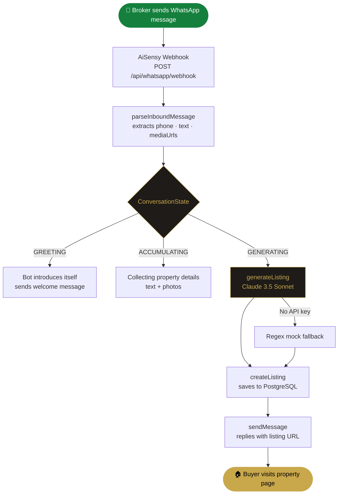
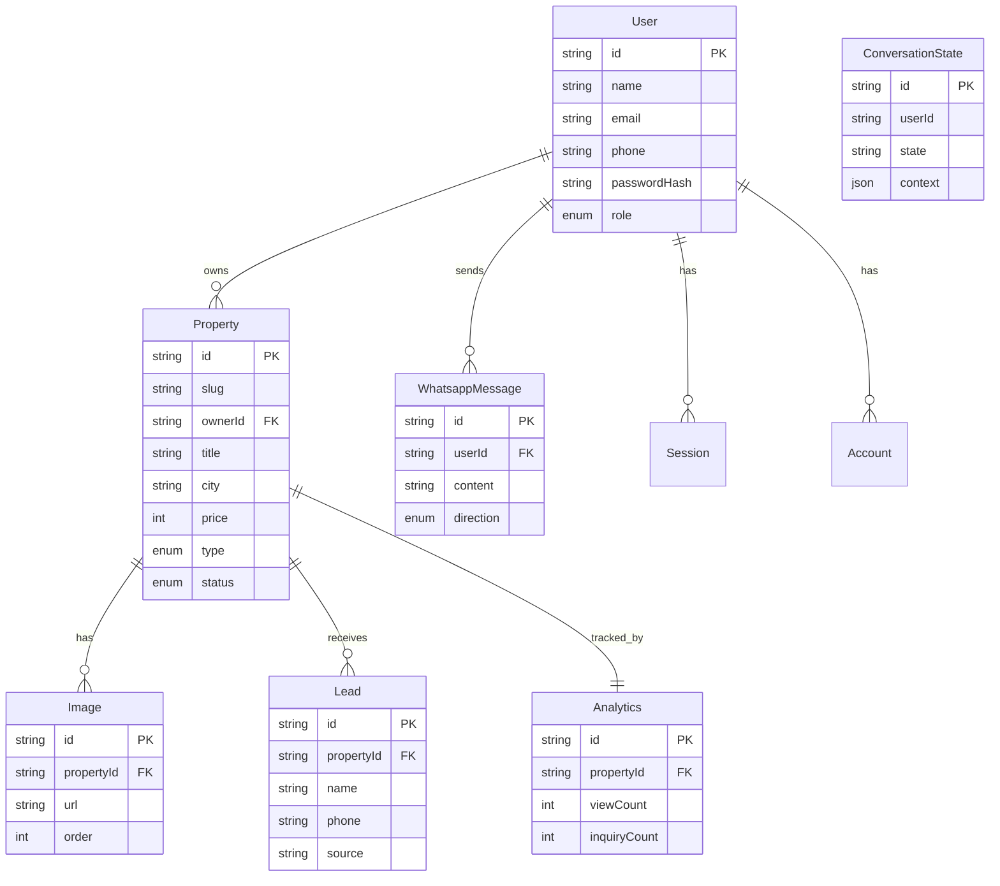
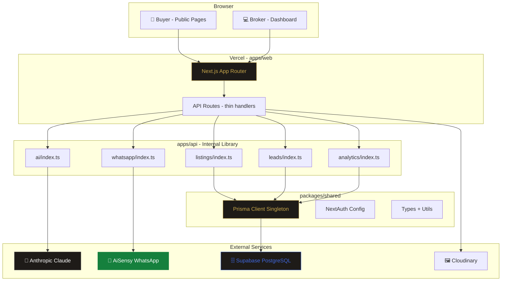

<div align="center">


# Brisvora

### AI-Powered Growth OS for Indian Real Estate Brokers

**"One Message. Unlimited Growth."**

[](https://brisvora.vercel.app)
[](https://nextjs.org)
[](https://typescriptlang.org)
[](https://supabase.com)
[](#testing)
[](#license)

</div>

---

## 🔗 Quick Links

| | Local | Production |
|---|---|---|
| 🏠 Homepage | [localhost:3000](http://localhost:3000) | [brisvora.vercel.app](https://brisvora.vercel.app) |
| 🔐 Login | [localhost:3000/login](http://localhost:3000/login) | [brisvora.vercel.app/login](https://brisvora.vercel.app/login) |
| 📝 Register | [localhost:3000/register](http://localhost:3000/register) | [brisvora.vercel.app/register](https://brisvora.vercel.app/register) |
| 📊 Dashboard | [localhost:3000/dashboard](http://localhost:3000/dashboard) | [brisvora.vercel.app/dashboard](https://brisvora.vercel.app/dashboard) |
| 📈 Growth OS | [localhost:3000/dashboard/growth](http://localhost:3000/dashboard/growth) | [brisvora.vercel.app/dashboard/growth](https://brisvora.vercel.app/dashboard/growth) |
| 🏘️ Listings | [localhost:3000/dashboard/listings](http://localhost:3000/dashboard/listings) | [brisvora.vercel.app/dashboard/listings](https://brisvora.vercel.app/dashboard/listings) |
| ➕ New Listing | [localhost:3000/dashboard/listings/new](http://localhost:3000/dashboard/listings/new) | [brisvora.vercel.app/dashboard/listings/new](https://brisvora.vercel.app/dashboard/listings/new) |
| 📬 Leads | [localhost:3000/dashboard/leads](http://localhost:3000/dashboard/leads) | [brisvora.vercel.app/dashboard/leads](https://brisvora.vercel.app/dashboard/leads) |
| 👤 Profile | [localhost:3000/dashboard/profile](http://localhost:3000/dashboard/profile) | [brisvora.vercel.app/dashboard/profile](https://brisvora.vercel.app/dashboard/profile) |
| 🛡️ Admin | [localhost:3000/admin](http://localhost:3000/admin) | [brisvora.vercel.app/admin](https://brisvora.vercel.app/admin) |
| 💰 Pricing | [localhost:3000/pricing](http://localhost:3000/pricing) | [brisvora.vercel.app/pricing](https://brisvora.vercel.app/pricing) |
| 📖 Docs | [localhost:3000/docs](http://localhost:3000/docs) | [brisvora.vercel.app/docs](https://brisvora.vercel.app/docs) |
| 🗺️ Sitemap | [localhost:3000/sitemap.xml](http://localhost:3000/sitemap.xml) | [brisvora.vercel.app/sitemap.xml](https://brisvora.vercel.app/sitemap.xml) |
| 🤖 Robots | [localhost:3000/robots.txt](http://localhost:3000/robots.txt) | [brisvora.vercel.app/robots.txt](https://brisvora.vercel.app/robots.txt) |


---

## 🧠 What Is Brisvora?

Brisvora is a **WhatsApp-native, AI-powered real estate listing platform** built for Indian brokers.

A broker sends a WhatsApp message describing a property → **Claude 3.5 Sonnet** extracts every detail → writes a professional SEO-optimized listing → saves to PostgreSQL → replies with a shareable public URL. Buyers browse listings, submit leads, and contact brokers directly.

---

## ⚡ Core Flow

```
Broker sends WhatsApp message (text + photos)
        │
        ▼
AiSensy webhook  →  POST /api/whatsapp/webhook
        │
        ▼
parseInboundMessage()  →  extracts phone, text, mediaUrls
        │
        ▼
ConversationState machine  →  GREETING → ACCUMULATING → GENERATING
        │
        ▼
generateListing()  →  Claude 3.5 Sonnet  (regex mock fallback if no API key)
        │
        ▼
createListing()  →  saves to PostgreSQL with images
        │
        ▼
sendMessage()  →  replies to broker with listing URL
        │
        ▼
Buyer visits  https://brisvora.vercel.app/property/[slug]
```



---

## 🛠️ Tech Stack

| Layer | Technology | Version |
|---|---|---|
| Framework | [Next.js](https://nextjs.org) App Router | 16.2.9 |
| UI Library | [React](https://react.dev) | 19.2.4 |
| Language | [TypeScript](https://typescriptlang.org) | 5.x |
| Styling | [Tailwind CSS](https://tailwindcss.com) v4 + CSS custom properties | 4.x |
| Typography | Playfair Display · Cinzel · DM Sans | Google Fonts |
| Auth | [NextAuth](https://authjs.dev) v5 beta + Prisma adapter | 5.0.0-beta.31 |
| Database | [PostgreSQL](https://supabase.com) via Supabase | — |
| ORM | [Prisma](https://prisma.io) | latest |
| AI | [Claude 3.5 Sonnet](https://anthropic.com) — regex mock fallback | Anthropic SDK |
| WhatsApp | [AiSensy](https://aisensy.com) API (webhook + send) | — |
| Images | [Cloudinary](https://cloudinary.com) — optional, fallback exists | — |
| Testing | [Vitest](https://vitest.dev) + [MSW](https://mswjs.io) | 4.x + 2.x |
| Monorepo | [pnpm](https://pnpm.io) 9 + [Turborepo](https://turbo.build) | 9.15.0 + 2.x |
| Deployment | [Vercel](https://vercel.com) | — |


---

## 📁 Monorepo Structure

```
BRISVORA/
├── apps/
│   ├── web/                          # Next.js 16 — only running server (port 3000)
│   │   ├── app/
│   │   │   ├── (auth)/
│   │   │   │   ├── login/page.tsx
│   │   │   │   └── register/page.tsx
│   │   │   ├── dashboard/
│   │   │   │   ├── growth/page.tsx   # Default dashboard redirect
│   │   │   │   ├── listings/
│   │   │   │   │   ├── page.tsx
│   │   │   │   │   ├── new/page.tsx
│   │   │   │   │   └── [id]/edit/page.tsx
│   │   │   │   ├── leads/page.tsx
│   │   │   │   ├── analytics/page.tsx
│   │   │   │   ├── activity/page.tsx
│   │   │   │   └── profile/page.tsx
│   │   │   ├── property/[slug]/page.tsx   # Public SSR listing page
│   │   │   ├── admin/                     # Role-gated admin panel
│   │   │   ├── api/
│   │   │   │   ├── auth/[...nextauth]/route.ts
│   │   │   │   ├── whatsapp/webhook/route.ts
│   │   │   │   ├── broker/
│   │   │   │   │   ├── listings/route.ts
│   │   │   │   │   ├── listings/[id]/route.ts
│   │   │   │   │   ├── leads/route.ts
│   │   │   │   │   ├── analytics/route.ts
│   │   │   │   │   └── profile/route.ts
│   │   │   │   ├── properties/route.ts
│   │   │   │   ├── properties/[slug]/route.ts
│   │   │   │   ├── leads/route.ts
│   │   │   │   ├── register/route.ts
│   │   │   │   └── upload/route.ts
│   │   │   ├── about/ blog/ contact/ pricing/
│   │   │   ├── features/ solutions/ docs/ guides/ help/
│   │   │   ├── roadmap/ changelog/ security/
│   │   │   ├── privacy-policy/ terms/ cookies/ licenses/
│   │   │   ├── webhooks/ sdks/
│   │   │   ├── globals.css            # Full design token system
│   │   │   ├── layout.tsx             # Root layout + SEO metadata
│   │   │   ├── page.tsx               # Public homepage
│   │   │   ├── robots.ts              # Auto-generated robots.txt
│   │   │   └── sitemap.ts             # Auto-generated sitemap.xml
│   │   ├── components/
│   │   │   ├── Navbar.tsx             # Sticky nav + dropdowns + mobile drawer
│   │   │   ├── Hero.tsx               # Animated hero with workflow panel
│   │   │   ├── Footer.tsx             # Newsletter + trust badges + social
│   │   │   ├── PricingSection.tsx     # 4-tier pricing + ROI calculator
│   │   │   ├── Icons.tsx              # Pure SVG icon set
│   │   │   └── ...12 more sections
│   │   ├── __tests__/
│   │   │   ├── api.edge-cases.test.ts        # 36 API tests
│   │   │   └── dashboard.edge-cases.test.ts  # 8 dashboard tests
│   │   ├── public/
│   │   │   ├── Brisvora.png           # Logo (OG image)
│   │   │   └── favicon.png
│   │   ├── auth.ts                    # NextAuth instance
│   │   ├── next.config.ts
│   │   └── .env.example               # Environment variable template
│   │
│   └── api/                           # Internal TS library — NOT a server
│       └── src/
│           ├── ai/index.ts            # generateListing() — Claude + fallback
│           ├── whatsapp/index.ts      # parseInboundMessage() · sendMessage()
│           ├── listings/index.ts      # Full CRUD + search + view count
│           ├── leads/index.ts         # createLead() · getBrokerLeads()
│           ├── analytics/index.ts     # getBrokerAnalytics()
│           ├── images/index.ts        # Cloudinary upload helpers
│           ├── conversation/index.ts  # State machine
│           └── index.ts               # Re-exports everything
│
├── packages/
│   └── shared/                        # Shared across all apps
│       ├── src/
│       │   ├── types/index.ts         # All TypeScript interfaces + Zod schemas
│       │   ├── utils/index.ts         # generateSlug() + helpers
│       │   ├── db.ts                  # Prisma client singleton
│       │   ├── auth.ts                # NextAuth authConfig
│       │   └── index.ts
│       └── prisma/
│           └── schema.prisma          # Full DB schema
│
├── turbo.json                         # Task pipeline
├── pnpm-workspace.yaml
├── package.json                       # Root scripts
└── README.md
```


---

## 🚀 Getting Started

### Prerequisites

| Tool | Version | Install |
|---|---|---|
| Node.js | ≥ 18.0.0 | [nodejs.org](https://nodejs.org) |
| pnpm | ≥ 9.0.0 | `npm install -g pnpm@9` |
| PostgreSQL | any | [Supabase](https://supabase.com) (recommended) |
| Git | any | [git-scm.com](https://git-scm.com) |

---

### Installation

```bash
# 1. Clone the repository
git clone https://github.com/DeadCoder-N/BRISVORA.git
cd BRISVORA

# 2. Install all dependencies (all workspaces)
pnpm install

# 3. Set up environment variables
cp apps/web/.env.example apps/web/.env.local
# → Edit apps/web/.env.local with your values (see below)

# 4. Generate Prisma client
pnpm db:generate

# 5. Run database migrations
pnpm db:migrate

# 6. Start the development server
pnpm dev
```

> App runs at **[http://localhost:3000](http://localhost:3000)**

---

### Environment Variables

Create `apps/web/.env.local` from the example:

```bash
cp apps/web/.env.example apps/web/.env.local
```

```env
# ─────────────────────────────────────────────
# REQUIRED — App will not start without these
# ─────────────────────────────────────────────

# PostgreSQL connection string (Supabase recommended)
DATABASE_URL=postgresql://<user>:<password>@<host>:5432/postgres

# NextAuth secret — generate with: openssl rand -base64 32
AUTH_SECRET=<your_secret_here>

# App URL (change to production URL on Vercel)
NEXTAUTH_URL=http://localhost:3000

# ─────────────────────────────────────────────
# WHATSAPP — AiSensy API
# Get from: https://aisensy.com → API Settings
# ─────────────────────────────────────────────
AISENSY_API_KEY=<your_aisensy_campaign_api_key>
AISENSY_PHONE_NUMBER=<your_aisensy_whatsapp_number>

# ─────────────────────────────────────────────
# AI — Anthropic Claude 3.5 Sonnet
# Optional: regex mock fallback works without this
# Get from: https://console.anthropic.com
# ─────────────────────────────────────────────
ANTHROPIC_API_KEY=<your_anthropic_api_key>

# ─────────────────────────────────────────────
# IMAGES — Cloudinary
# Optional: listings work without images
# Get from: https://cloudinary.com → Dashboard
# ─────────────────────────────────────────────
CLOUDINARY_CLOUD_NAME=<your_cloud_name>
CLOUDINARY_API_KEY=<your_cloudinary_api_key>
CLOUDINARY_API_SECRET=<your_cloudinary_api_secret>

# ─────────────────────────────────────────────
# ANALYTICS — Google Analytics 4
# Optional
# ─────────────────────────────────────────────
NEXT_PUBLIC_GA_ID=G-XXXXXXXXXX
```

> `packages/shared/.env` only needs `DATABASE_URL` for Prisma CLI commands.

---

### All Commands

```bash
# ── Development ──────────────────────────────
pnpm dev              # Start all apps in parallel (port 3000)
pnpm build            # Production build
pnpm lint             # ESLint across all packages
pnpm type-check       # TypeScript check across all packages

# ── Testing ──────────────────────────────────
pnpm test:run         # Run all 44 tests (Vitest + MSW)
cd apps/web && pnpm test        # Watch mode
cd apps/web && pnpm test:ui     # Vitest UI in browser
cd apps/web && pnpm coverage    # Coverage report

# ── Database ─────────────────────────────────
pnpm db:generate      # Regenerate Prisma client after schema changes
pnpm db:migrate       # Run pending migrations (dev)
pnpm db:studio        # Open Prisma Studio GUI at localhost:5555
```


---

## 🔌 API Reference

All routes are under `apps/web/app/api/`. Route handlers are thin — all business logic lives in `@brisvora/api`.

### Auth Routes

| Method | Local URL | Production URL | Auth | Purpose |
|---|---|---|---|---|
| `GET POST` | [/api/auth/\[...nextauth\]](http://localhost:3000/api/auth/signin) | [/api/auth/\[...nextauth\]](https://brisvora.vercel.app/api/auth/signin) | — | NextAuth handler |
| `POST` | [/api/register](http://localhost:3000/api/register) | [/api/register](https://brisvora.vercel.app/api/register) | — | Broker registration |

### WhatsApp Routes

| Method | Local URL | Production URL | Auth | Purpose |
|---|---|---|---|---|
| `GET` | [/api/whatsapp/webhook](http://localhost:3000/api/whatsapp/webhook) | [/api/whatsapp/webhook](https://brisvora.vercel.app/api/whatsapp/webhook) | Token | AiSensy verification |
| `POST` | [/api/whatsapp/webhook](http://localhost:3000/api/whatsapp/webhook) | [/api/whatsapp/webhook](https://brisvora.vercel.app/api/whatsapp/webhook) | Signature | Inbound message handler |

### Broker Routes (🔒 Session required)

| Method | Local URL | Production URL | Purpose |
|---|---|---|---|
| `GET POST` | [/api/broker/listings](http://localhost:3000/api/broker/listings) | [/api/broker/listings](https://brisvora.vercel.app/api/broker/listings) | List / create listings |
| `PUT DELETE` | `/api/broker/listings/[id]` | `/api/broker/listings/[id]` | Update / delete listing |
| `GET` | [/api/broker/leads](http://localhost:3000/api/broker/leads) | [/api/broker/leads](https://brisvora.vercel.app/api/broker/leads) | All leads for broker |
| `GET` | [/api/broker/analytics](http://localhost:3000/api/broker/analytics) | [/api/broker/analytics](https://brisvora.vercel.app/api/broker/analytics) | Dashboard analytics |
| `GET PUT` | [/api/broker/profile](http://localhost:3000/api/broker/profile) | [/api/broker/profile](https://brisvora.vercel.app/api/broker/profile) | Broker profile |

### Public Routes (🌐 No auth)

| Method | Local URL | Production URL | Purpose |
|---|---|---|---|
| `GET` | [/api/properties](http://localhost:3000/api/properties) | [/api/properties](https://brisvora.vercel.app/api/properties) | Search listings (city, price, type, BHK) |
| `GET` | `/api/properties/[slug]` | `/api/properties/[slug]` | Single property + view count |
| `POST` | [/api/leads](http://localhost:3000/api/leads) | [/api/leads](https://brisvora.vercel.app/api/leads) | Submit buyer inquiry |
| `POST` | [/api/upload](http://localhost:3000/api/upload) | [/api/upload](https://brisvora.vercel.app/api/upload) | Upload image to Cloudinary |

### Admin Routes (🛡️ ADMIN role required)

| Method | Local URL | Production URL | Purpose |
|---|---|---|---|
| `GET` | [/api/admin](http://localhost:3000/api/admin) | [/api/admin](https://brisvora.vercel.app/api/admin) | Admin stats |
| `GET` | [/api/admin/users](http://localhost:3000/api/admin/users) | [/api/admin/users](https://brisvora.vercel.app/api/admin/users) | All broker accounts |
| `GET` | [/api/admin/properties](http://localhost:3000/api/admin/properties) | [/api/admin/properties](https://brisvora.vercel.app/api/admin/properties) | All properties |
| `GET` | [/api/admin/leads](http://localhost:3000/api/admin/leads) | [/api/admin/leads](https://brisvora.vercel.app/api/admin/leads) | All leads |
| `GET` | [/api/admin/messages](http://localhost:3000/api/admin/messages) | [/api/admin/messages](https://brisvora.vercel.app/api/admin/messages) | WhatsApp message log |


---

## 🌐 All Pages

### Public Pages

| Page | Local | Production |
|---|---|---|
| Homepage | [localhost:3000](http://localhost:3000) | [brisvora.vercel.app](https://brisvora.vercel.app) |
| Property Listing | `localhost:3000/property/[slug]` | `brisvora.vercel.app/property/[slug]` |
| About | [localhost:3000/about](http://localhost:3000/about) | [brisvora.vercel.app/about](https://brisvora.vercel.app/about) |
| Blog | [localhost:3000/blog](http://localhost:3000/blog) | [brisvora.vercel.app/blog](https://brisvora.vercel.app/blog) |
| Contact | [localhost:3000/contact](http://localhost:3000/contact) | [brisvora.vercel.app/contact](https://brisvora.vercel.app/contact) |
| Pricing | [localhost:3000/pricing](http://localhost:3000/pricing) | [brisvora.vercel.app/pricing](https://brisvora.vercel.app/pricing) |
| Features | [localhost:3000/features](http://localhost:3000/features) | [brisvora.vercel.app/features](https://brisvora.vercel.app/features) |
| Solutions | [localhost:3000/solutions](http://localhost:3000/solutions) | [brisvora.vercel.app/solutions](https://brisvora.vercel.app/solutions) |
| Docs | [localhost:3000/docs](http://localhost:3000/docs) | [brisvora.vercel.app/docs](https://brisvora.vercel.app/docs) |
| Guides | [localhost:3000/guides](http://localhost:3000/guides) | [brisvora.vercel.app/guides](https://brisvora.vercel.app/guides) |
| Help | [localhost:3000/help](http://localhost:3000/help) | [brisvora.vercel.app/help](https://brisvora.vercel.app/help) |
| Roadmap | [localhost:3000/roadmap](http://localhost:3000/roadmap) | [brisvora.vercel.app/roadmap](https://brisvora.vercel.app/roadmap) |
| Changelog | [localhost:3000/changelog](http://localhost:3000/changelog) | [brisvora.vercel.app/changelog](https://brisvora.vercel.app/changelog) |
| Security | [localhost:3000/security](http://localhost:3000/security) | [brisvora.vercel.app/security](https://brisvora.vercel.app/security) |
| Privacy Policy | [localhost:3000/privacy-policy](http://localhost:3000/privacy-policy) | [brisvora.vercel.app/privacy-policy](https://brisvora.vercel.app/privacy-policy) |
| Terms | [localhost:3000/terms](http://localhost:3000/terms) | [brisvora.vercel.app/terms](https://brisvora.vercel.app/terms) |
| Cookies | [localhost:3000/cookies](http://localhost:3000/cookies) | [brisvora.vercel.app/cookies](https://brisvora.vercel.app/cookies) |
| Licenses | [localhost:3000/licenses](http://localhost:3000/licenses) | [brisvora.vercel.app/licenses](https://brisvora.vercel.app/licenses) |
| Webhooks | [localhost:3000/webhooks](http://localhost:3000/webhooks) | [brisvora.vercel.app/webhooks](https://brisvora.vercel.app/webhooks) |
| SDKs | [localhost:3000/sdks](http://localhost:3000/sdks) | [brisvora.vercel.app/sdks](https://brisvora.vercel.app/sdks) |

### Auth Pages

| Page | Local | Production |
|---|---|---|
| Login | [localhost:3000/login](http://localhost:3000/login) | [brisvora.vercel.app/login](https://brisvora.vercel.app/login) |
| Register | [localhost:3000/register](http://localhost:3000/register) | [brisvora.vercel.app/register](https://brisvora.vercel.app/register) |

### Dashboard Pages (🔒 Auth required)

| Page | Local | Production |
|---|---|---|
| Growth OS | [localhost:3000/dashboard/growth](http://localhost:3000/dashboard/growth) | [brisvora.vercel.app/dashboard/growth](https://brisvora.vercel.app/dashboard/growth) |
| Listings | [localhost:3000/dashboard/listings](http://localhost:3000/dashboard/listings) | [brisvora.vercel.app/dashboard/listings](https://brisvora.vercel.app/dashboard/listings) |
| New Listing | [localhost:3000/dashboard/listings/new](http://localhost:3000/dashboard/listings/new) | [brisvora.vercel.app/dashboard/listings/new](https://brisvora.vercel.app/dashboard/listings/new) |
| Edit Listing | `localhost:3000/dashboard/listings/[id]/edit` | `brisvora.vercel.app/dashboard/listings/[id]/edit` |
| Leads | [localhost:3000/dashboard/leads](http://localhost:3000/dashboard/leads) | [brisvora.vercel.app/dashboard/leads](https://brisvora.vercel.app/dashboard/leads) |
| Analytics | [localhost:3000/dashboard/analytics](http://localhost:3000/dashboard/analytics) | [brisvora.vercel.app/dashboard/analytics](https://brisvora.vercel.app/dashboard/analytics) |
| Activity | [localhost:3000/dashboard/activity](http://localhost:3000/dashboard/activity) | [brisvora.vercel.app/dashboard/activity](https://brisvora.vercel.app/dashboard/activity) |
| Profile | [localhost:3000/dashboard/profile](http://localhost:3000/dashboard/profile) | [brisvora.vercel.app/dashboard/profile](https://brisvora.vercel.app/dashboard/profile) |

### Admin Pages (🛡️ ADMIN role required)

| Page | Local | Production |
|---|---|---|
| Admin Panel | [localhost:3000/admin](http://localhost:3000/admin) | [brisvora.vercel.app/admin](https://brisvora.vercel.app/admin) |
| Users | [localhost:3000/admin/users](http://localhost:3000/admin/users) | [brisvora.vercel.app/admin/users](https://brisvora.vercel.app/admin/users) |
| Properties | [localhost:3000/admin/properties](http://localhost:3000/admin/properties) | [brisvora.vercel.app/admin/properties](https://brisvora.vercel.app/admin/properties) |
| Leads | [localhost:3000/admin/leads](http://localhost:3000/admin/leads) | [brisvora.vercel.app/admin/leads](https://brisvora.vercel.app/admin/leads) |
| Messages | [localhost:3000/admin/messages](http://localhost:3000/admin/messages) | [brisvora.vercel.app/admin/messages](https://brisvora.vercel.app/admin/messages) |

---

## 🗄️ Database Schema

```
User ──────────────────────────────────────────────────────────────
  id · name · email (unique) · phone (unique) · passwordHash
  role: BROKER | ADMIN | SUPER_ADMIN
  → properties[] · whatsappMessages[] · sessions[] · accounts[]

Property ──────────────────────────────────────────────────────────
  id · slug (unique) · ownerId · ownerPhone
  title · description · address · city
  price · priceLabel · bedrooms · bathrooms · areaSqft
  type: APARTMENT | HOUSE | VILLA | PLOT | COMMERCIAL | OTHER
  status: ACTIVE | INACTIVE | SOLD | RENTED
  features[] · amenities[] · rawInput
  → owner (User) · images[] · leads[] · analytics

Image ─────────────────────────────────────────────────────────────
  id · propertyId · url · thumbnailUrl · caption · order

Lead ──────────────────────────────────────────────────────────────
  id · propertyId · name · phone · message
  source: "whatsapp" | "web"

Analytics ─────────────────────────────────────────────────────────
  id · propertyId (unique) · viewCount · inquiryCount · lastViewed

WhatsappMessage ───────────────────────────────────────────────────
  id · userId · waId · content
  direction: INBOUND | OUTBOUND
  status · timestamp

ConversationState ─────────────────────────────────────────────────
  id · userId (unique) · state · context (JSON) · lastMessageAt

Account · Session · VerificationToken  →  NextAuth standard models
```



---

## 🎨 Brand System

| Token | Value | Usage |
|---|---|---|
| `--gold` | `#C9A84C` | Accent, buttons, highlights |
| `--gold-light` | `#D4A837` | Hover states |
| `--gold-bright` | `#F5D080` | Shimmer, gradients |
| `--green` | `#15803D` | Success, WhatsApp, positive metrics |
| `--bg` | `#080807` | Deep dark background |
| `--surface-1` | `#0F0E0C` | Elevated surface |
| `--surface-2` | `#161412` | Cards |
| `--text-primary` | `#F0EBE0` | Warm white text |
| `--text-secondary` | `#A89878` | Subdued text |
| `--text-muted` | `#6B5E45` | Placeholder, labels |
| Playfair Display | Serif | Headings and titles |
| Cinzel | Ornamental serif | Section labels (uppercase, spaced) |
| DM Sans | Sans-serif | Body text and UI |

> Both dark and light themes are fully implemented via `[data-theme="light"]` overrides.


---

## 🚢 Deployment

### Vercel (Production)

The app is deployed at **[brisvora.vercel.app](https://brisvora.vercel.app)**

**Vercel Project Settings:**

```
Root Directory:   apps/web
Output Directory: .next
Framework Preset: Next.js

Build Command:
  cd ../.. && cd packages/shared && npx prisma generate && cd ../.. && pnpm --filter web build

Install Command:
  cd ../.. && pnpm install --no-frozen-lockfile
```

**Required Environment Variables on Vercel:**

Go to `Vercel → Project → Settings → Environment Variables` and add:

```
DATABASE_URL          → Supabase connection string
AUTH_SECRET           → openssl rand -base64 32
NEXTAUTH_URL          → https://brisvora.vercel.app
AISENSY_API_KEY       → AiSensy campaign API key
AISENSY_PHONE_NUMBER  → AiSensy WhatsApp number
ANTHROPIC_API_KEY     → Anthropic console key (optional)
CLOUDINARY_CLOUD_NAME → Cloudinary dashboard (optional)
CLOUDINARY_API_KEY    → Cloudinary dashboard (optional)
CLOUDINARY_API_SECRET → Cloudinary dashboard (optional)
```

---

### WhatsApp Webhook Setup (AiSensy)

1. Go to [AiSensy Dashboard](https://aisensy.com) → API Settings
2. Set webhook URL:
   ```
   https://brisvora.vercel.app/api/whatsapp/webhook
   ```
3. Set verify token (must match `AISENSY_API_KEY` in env)
4. Enable: **Message Received** events
5. Test with GET request — should return `200 OK`

**Webhook flow test:**
```bash
# Verify endpoint is live
curl https://brisvora.vercel.app/api/whatsapp/webhook

# Local test (dev)
curl http://localhost:3000/api/whatsapp/webhook
```

---

## 🧪 Testing

**44 tests** across 2 test files using **Vitest + MSW**.

```bash
# Run all tests
cd apps/web
pnpm test:run

# Watch mode
pnpm test

# Browser UI
pnpm test:ui

# Coverage report
pnpm coverage
```

### Test Files

| File | Tests | Coverage |
|---|---|---|
| [`__tests__/api.edge-cases.test.ts`](apps/web/__tests__/api.edge-cases.test.ts) | 36 | All API routes — auth, listings, properties, leads, analytics, upload, profile |
| [`__tests__/dashboard.edge-cases.test.ts`](apps/web/__tests__/dashboard.edge-cases.test.ts) | 8 | Dashboard analytics edge cases |

**MSW handlers** are shared between browser dev mode and Vitest — same mocks everywhere.


---

## 📊 Project Status

> **Overall Completion: ~85%** — Production live, core flows working, critical integrations need final wiring.

---

### ✅ Done

<details>
<summary><strong>Infrastructure & Deployment</strong></summary>

- [x] Turborepo monorepo with pnpm workspaces
- [x] Supabase PostgreSQL connected and migrated
- [x] Prisma schema — all models, relations, indexes
- [x] Vercel deployment — production live at [brisvora.vercel.app](https://brisvora.vercel.app)
- [x] All TypeScript issues resolved, production build passing

</details>

<details>
<summary><strong>Authentication</strong></summary>

- [x] Register page [`/register`](https://brisvora.vercel.app/register) — bcrypt password hashing
- [x] Login page [`/login`](https://brisvora.vercel.app/login) — NextAuth credentials provider
- [x] Session provider in root layout
- [x] Dashboard route protection via middleware
- [x] Role-based access: `BROKER` / `ADMIN` / `SUPER_ADMIN`
- [x] Sign out button (client component)

</details>

<details>
<summary><strong>WhatsApp Integration</strong></summary>

- [x] AiSensy webhook endpoint — GET verification + POST handler
- [x] Inbound message parsing (`parseInboundMessage`)
- [x] Outbound message sending (`sendMessage`)
- [x] Media download (`downloadMedia`)
- [x] Conversation state machine: `GREETING → ACCUMULATING → GENERATING`

</details>

<details>
<summary><strong>AI Listing Generation</strong></summary>

- [x] Claude 3.5 Sonnet integration (`generateListing`)
- [x] Regex mock fallback — works without `ANTHROPIC_API_KEY`
- [x] Structured JSON extraction: title, description, price, BHK, city, type, features, amenities

</details>

<details>
<summary><strong>Backend API</strong></summary>

- [x] All broker CRUD routes — listings, leads, analytics, profile
- [x] Public property search with filters: city, price, type, bedrooms
- [x] Single property page with view count increment
- [x] Lead submission from public listing page
- [x] Image upload to Cloudinary
- [x] Admin API routes — users, properties, leads, messages

</details>

<details>
<summary><strong>Frontend — Public</strong></summary>

- [x] Homepage [`/`](https://brisvora.vercel.app) — 12 marketing sections: Hero, Trust, Problem, Solution, Ecosystem, Growth Dashboard, Solutions, Integrations, Customer Success, Pricing, FAQ, CTA
- [x] Premium Navbar — dropdown menus, scroll progress bar, theme toggle, mobile drawer
- [x] Footer — newsletter, trust badges, social links, legal links
- [x] Public property listing page [`/property/[slug]`](https://brisvora.vercel.app) — SSR, SEO meta, image gallery, lead form, mobile contact bar
- [x] Property search — city / type / BHK / price filters
- [x] All 20+ marketing pages — [about](https://brisvora.vercel.app/about), [blog](https://brisvora.vercel.app/blog), [contact](https://brisvora.vercel.app/contact), [pricing](https://brisvora.vercel.app/pricing), [features](https://brisvora.vercel.app/features), [solutions](https://brisvora.vercel.app/solutions), [docs](https://brisvora.vercel.app/docs), [guides](https://brisvora.vercel.app/guides), [help](https://brisvora.vercel.app/help), [roadmap](https://brisvora.vercel.app/roadmap), [changelog](https://brisvora.vercel.app/changelog), [security](https://brisvora.vercel.app/security), [privacy-policy](https://brisvora.vercel.app/privacy-policy), [terms](https://brisvora.vercel.app/terms)

</details>

<details>
<summary><strong>Frontend — Dashboard</strong></summary>

- [x] Growth dashboard [`/dashboard/growth`](https://brisvora.vercel.app/dashboard/growth) — stat cards, 30-day views chart, lead source donut, conversion funnel, AI insights, top listings table, recent leads
- [x] Listings page [`/dashboard/listings`](https://brisvora.vercel.app/dashboard/listings) — table with edit/delete
- [x] Create listing [`/dashboard/listings/new`](https://brisvora.vercel.app/dashboard/listings/new) — AI text input + image upload with drag & drop
- [x] Edit listing `/dashboard/listings/[id]/edit`
- [x] Leads page [`/dashboard/leads`](https://brisvora.vercel.app/dashboard/leads) — source filtering
- [x] Analytics, Activity, Profile pages
- [x] Dashboard sidebar with navigation
- [x] Mobile bottom navigation bar

</details>

<details>
<summary><strong>Admin Panel</strong></summary>

- [x] Admin dashboard [`/admin`](https://brisvora.vercel.app/admin)
- [x] Admin users, properties, leads, messages pages

</details>

<details>
<summary><strong>SEO</strong></summary>

- [x] Organization JSON-LD schema
- [x] WebSite JSON-LD with SearchAction
- [x] RealEstateListing JSON-LD per property page
- [x] BreadcrumbList JSON-LD per property page
- [x] Dynamic Open Graph + Twitter Cards per property
- [x] Auto-generated [`sitemap.xml`](https://brisvora.vercel.app/sitemap.xml) — up to 10,000 properties
- [x] [`robots.txt`](https://brisvora.vercel.app/robots.txt)
- [x] Google Search Console verification tag

</details>

<details>
<summary><strong>Design System</strong></summary>

- [x] Full CSS custom property token system — dark + light themes
- [x] Mobile-first responsive breakpoints: 480 → 768 → 1024 → 1400 → 1920px
- [x] `prefers-reduced-motion` support on all animations
- [x] Keyboard navigation + focus states
- [x] ARIA labels on all interactive elements
- [x] Pure SVG charts — no chart libraries
- [x] Grain texture overlay, gold dividers, animated entries

</details>

<details>
<summary><strong>Testing</strong></summary>

- [x] 44 tests passing (Vitest + MSW)
- [x] API edge case coverage
- [x] Dashboard analytics edge cases

</details>

---

### 🔧 Remaining

<details open>
<summary><strong>🚨 Critical — Blockers</strong></summary>

- [ ] **WhatsApp access token expired** — needs permanent System User token from [Meta Business Manager](https://business.facebook.com) → Settings → System Users
- [ ] **Broker phone not collected at registration** — WhatsApp can't match incoming message sender to a broker account
- [ ] **AiSensy full switch** — env vars updated, end-to-end flow needs verification
- [ ] **Cloudinary credentials not in production** — image upload inactive on live site

</details>

<details>
<summary><strong>⚠️ High Priority</strong></summary>

- [ ] Conversational WhatsApp flow — multi-step dialog, guided questions, context tracking per user
- [ ] Real date-based analytics — current 30-day chart uses simulated sine wave data
- [ ] `ANTHROPIC_API_KEY` in production — currently using regex mock fallback
- [ ] Hindi/Hinglish input handling in AI prompt

</details>

<details>
<summary><strong>📋 Medium Priority</strong></summary>

- [ ] Export leads to CSV
- [ ] Bulk listing actions — activate / deactivate / delete multiple
- [ ] Analytics events table with timestamps
- [ ] Razorpay / Stripe integration
- [ ] Plan enforcement — Starter / Professional / Business / Enterprise
- [ ] Redis caching for frequent DB queries

</details>

<details>
<summary><strong>🔮 Phase 2 — Future</strong></summary>

- [ ] Voice input for property descriptions
- [ ] OCR for property documents
- [ ] AI price estimation
- [ ] Automated follow-up WhatsApp messages to leads
- [ ] Multi-broker organization accounts
- [ ] Syndication to 99acres / MagicBricks / Housing.com
- [ ] A/B testing for listing descriptions
- [ ] Google Analytics 4 custom events: `ListingCreated`, `LeadSubmitted`, etc.
- [ ] Real-time analytics (currently static server render)

</details>


---

## 📐 Key Conventions

| Rule | Detail |
|---|---|
| DB access | Always through `@brisvora/shared` — never import Prisma directly in `web` |
| Business logic | Always in `@brisvora/api` modules — route handlers are thin wrappers |
| Slugs | Auto-generated from property title + UUID prefix via `generateSlug()` |
| Phone numbers | Normalized to digits-only — e.g. `918850908790` |
| Dashboard pages | Server Components by default — zero JS bundle |
| Charts | Pure SVG/CSS — no Recharts, Chart.js, or any chart library |
| Styling | Inline styles + CSS custom properties — no CSS modules or styled-components |
| Animations | `prefers-reduced-motion` respected on every animated element |
| Fonts | Loaded via `next/font/google` — no layout shift |
| Images | `next/image` with Cloudinary domains whitelisted in `next.config.ts` |

---

## 🏗️ Architecture Decisions

| Decision | Reason |
|---|---|
| Next.js App Router as only server | One Vercel project — no separate backend to deploy or maintain |
| `apps/api` as internal library | Business logic fully isolated from HTTP layer — testable in isolation |
| `packages/shared` for Prisma | Single DB connection singleton across all modules — no connection pool exhaustion |
| Pure SVG charts | Zero bundle cost, full design control, no dependency risk |
| Inline styles + CSS custom properties | Theme switching (dark/light) without CSS-in-JS runtime overhead |
| MSW for tests | Same mock handlers in browser dev mode and Vitest — no duplication |
| Turborepo | Parallel builds, incremental caching — fast CI |
| AiSensy over Meta Cloud API directly | Simpler onboarding, managed infrastructure, no Meta Business verification complexity |



---

## 🤝 Contributing

```bash
# 1. Fork and clone
git clone https://github.com/DeadCoder-N/BRISVORA.git
cd BRISVORA

# 2. Create a feature branch
git checkout -b feat/your-feature-name

# 3. Install dependencies
pnpm install

# 4. Make your changes

# 5. Run tests — must all pass
pnpm test:run

# 6. Run build — must succeed
pnpm build

# 7. Commit with conventional commits
git commit -m "feat: add conversational WhatsApp flow"
git commit -m "fix: broker phone collection at registration"
git commit -m "chore: update Anthropic SDK"

# 8. Push and open a PR
git push origin feat/your-feature-name
```

**Commit prefixes:** `feat:` · `fix:` · `chore:` · `docs:` · `refactor:` · `test:`

---

## 📄 License

Private — All rights reserved © 2026 Brisvora Technologies.

---

<div align="center">

**[🌐 Live Site](https://brisvora.vercel.app)** · **[📊 Dashboard](https://brisvora.vercel.app/dashboard)** · **[📖 Docs](https://brisvora.vercel.app/docs)** · **[💰 Pricing](https://brisvora.vercel.app/pricing)**

<br />

Built for businesses that grow. · Made in India 🇮🇳

</div>
