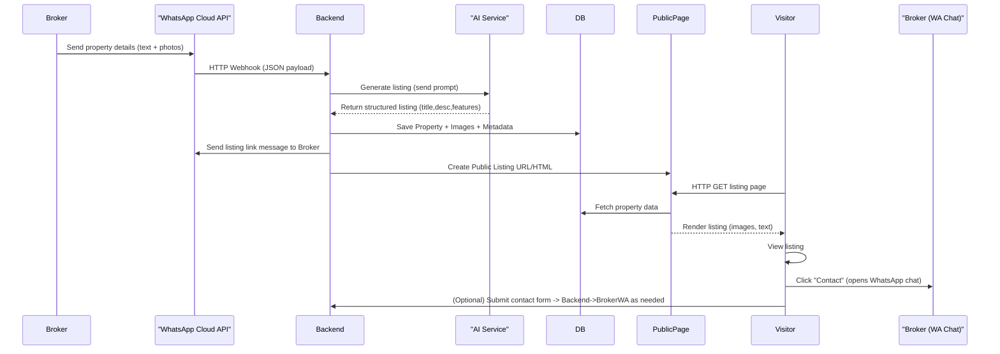
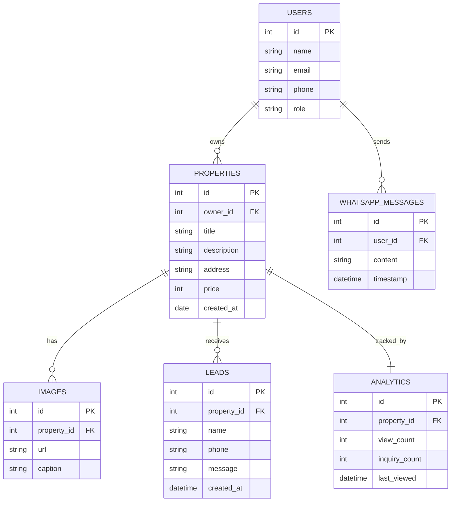
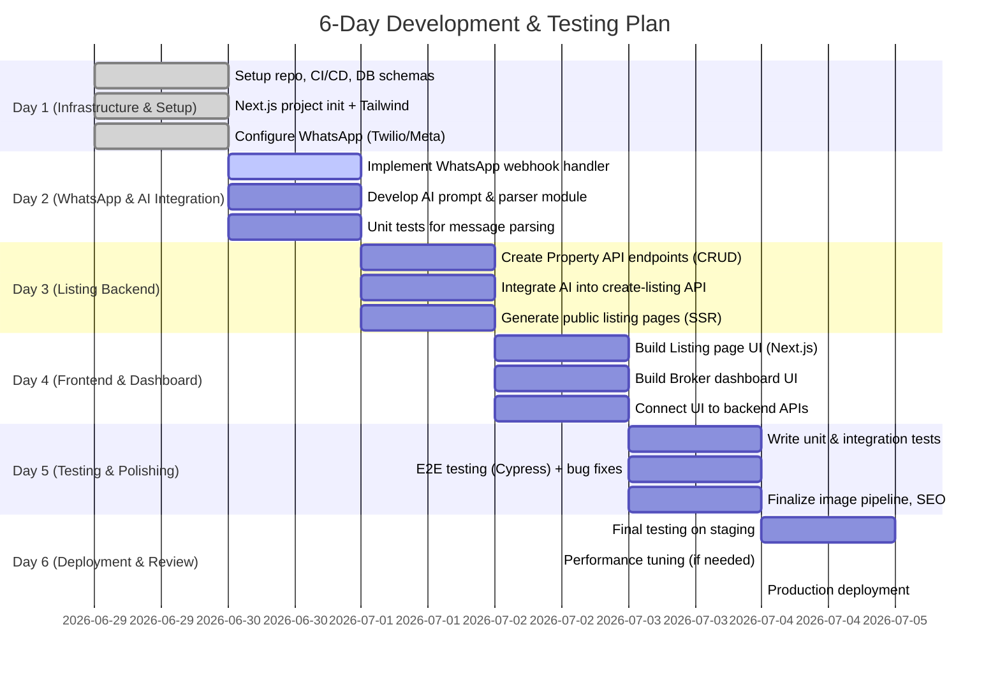

# Executive Summary

We propose building an **AI-powered property-listing platform** for Indian real estate brokers, similar to PropSite. This system lets brokers **send property details (via WhatsApp or a simple web form) and instantly get a polished listing page** (with title, description, images and SEO-friendly URL) generated by AI. Visitors to the listing page can contact the broker (e.g. via WhatsApp click-to-chat) and basic analytics (views, inquiries) are tracked. For MVP (5–6 days including testing), the focus is on the core flows: broker onboarding, WhatsApp message intake, AI listing generation, public listing pages, lead capture, and broker dashboard. Phase 2 (post-MVP) could add advanced AI (voice input, OCR), automated valuation, subscription plans, multi-agent support, full CRM features, and deeper analytics.

Key technologies include **Next.js + Tailwind CSS** for the frontend, **Node.js** (or NestJS) for APIs, **PostgreSQL** for data storage, **Redis** for caching, and **Anthropic Claude or OpenAI GPT** for AI generation. WhatsApp integration is via the **Meta (Facebook) WhatsApp Cloud API** or **Twilio’s WhatsApp service**. Images are stored and transformed with **Cloudinary** (or S3). The app is deployed on cloud (e.g. Vercel/Railway or AWS), with CI/CD via GitHub Actions. We design a scalable **microservices-style architecture** (see diagram below) but can start with a monorepo. A detailed 6-day plan breaks down tasks by hour for development, testing, and deployment. Security (end-to-end encryption, auth, rate-limiting, GDPR compliance) and SEO/localization (Hindi/Hinglish support) are addressed. We estimate minimal costs by using free tiers (Cloudinary/AWS free usage, trial AI credits, etc.) and a small team (2–3 devs + QA). Key risks (message quotas, AI accuracy, etc.) are mitigated by fallbacks and monitoring. 


# Product Overview

- **Goal:** Enable any real estate broker to rapidly create a professional listing from simple inputs. Brokers send details (text/WhatsApp or web form) and **AI generates a title, description, and a styled webpage** with SEO-friendly URL. The broker shares this link; interested buyers contact the broker via WhatsApp or form. Brokers see all their listings and analytics in a dashboard. 

- **MVP Scope (5–6 days):**  
  - Broker can **register/login** (basic auth).  
  - Broker sends property info via WhatsApp (or web UI) including photos and text in English or Hindi/Hinglish.  
  - The system uses AI to **parse the message and generate a listing** (title, description, formatted details).  
  - A **public listing page** is created (server-rendered) with images, map/location, and “Contact broker” link.  
  - A **broker dashboard** shows all listings, views, leads (contact clicks) and simple analytics.  
  - Contacts/leads from listing pages are sent to the broker (e.g. via WhatsApp message or email).  
  - Basic **search/filter** on listings (e.g. by city, price) to allow visitors to find properties.  

- **Phase 2 (Post-MVP features):**  
  - **AI Enhancements:** Voice-input or OCR to capture property details; auto-enhance images; AI-powered price estimates.  
  - **Chatbot/CRM:** Inbound AI chat assistant for buyers, automated follow-ups.  
  - **Subscriptions/Payments:** Plans for brokers, payment gateway integration.  
  - **Multi-Broker Support:** Organizational accounts, admin panels for multiple agents.  
  - **Marketing & SEO:** Syndication to major portals, rich SEO metadata, advanced SEO analytics.  
  - **Advanced Analytics:** Dashboards with conversion tracking, A/B testing of descriptions, etc.  

This approach dramatically lowers the barrier for non-technical brokers. For example, the PropSite product already reports “1,200+ brokers using PropSite to turn WhatsApp messages into listings” (implying strong demand). We focus the MVP on core value: **fast listing creation, WhatsApp-native workflow, and shareable pages**. 

# Functional Requirements and User Stories

- **Broker Registration/Login:**  
  - *User story:* As a new broker, I want to sign up or log in so I can access my dashboard and manage listings. (Implement secure email/phone + password or OAuth).  

- **WhatsApp Listing Creation:**  
  - *Story:* As a broker, I want to send a WhatsApp message (with text and photos) describing a property, and get back a shareable listing link automatically.  
  - *Flow:* Broker sends message to the business number → System receives via webhook → AI parses the message (extracts fields) and generates a title/description → A new listing page is created (with URL) → The system replies to the broker (via WhatsApp message) with the listing link.  

- **Web Form Listing Creation (Optional MVP):**  
  - *Story:* If no WhatsApp, broker can fill a simple web form (text fields + upload images) to create a listing.  

- **Public Listing Page:**  
  - *Story:* As a visitor, I want to view a listing page with images, description, and broker contact info. The page should be mobile-friendly and SEO-optimized.  
  - *Detail:* Listing page shows title, price, description, images carousel, amenities, and a “Contact Broker” CTA (whatsapp link or form).  

- **Broker Dashboard:**  
  - *Story:* As a broker, I want a dashboard showing all my listings, with key metrics (views, inquiries).  
  - *Features:* List of properties with status (active/expired), ability to edit or delete, view analytics (daily view counts), and see lead contacts (names/numbers/dates).  

- **Search & Filters:**  
  - *Story:* As a user, I want to search or filter listings (e.g. by city, price range, property type, bedrooms).  
  - *Detail:* Provide keyword search and basic filters on the listing index page or as API. For MVP, simple database queries can suffice (if volume is low).  

- **Lead Handling:**  
  - *Story:* As a broker, I want to be notified and record when someone shows interest.  
  - *Flow:* On listing page, clicking “Contact” opens a WhatsApp chat with broker (via wa.me link) and optionally triggers a backend log of a lead event. Alternatively, a simple contact form (name/phone/message) that emails or messages the broker.  

- **Analytics:**  
  - *Story:* As a broker, I want basic analytics (views per listing, referral source if possible) in my dashboard.  
  - *Detail:* Track each page view (via DB or Google Analytics) and aggregate. Show charts or simple numbers.  

- **Admin Panel (optional):**  
  - *Story:* As admin (internal), I can manage brokers, view usage, approve content if needed. (May skip in MVP.)  

# Non-Functional Requirements

- **Performance:**  
  - AI generation and page creation should be fast (< 1 min turnaround). Use async processing and caching where possible. Pages must load quickly for users (optimize images, use CDN).  
- **Scalability & Availability:**  
  - Design stateless services so we can horizontally scale. Use cloud services (managed DB, serverless functions) to easily handle load. The architecture can start as a monolith (Next.js + Node) but is designed so that future microservices (search engine, recommendation engine) can be split out. Early caches (Redis) can prevent repeated AI calls.  
- **Security & Privacy:**  
  - All traffic via HTTPS/TLS. WhatsApp messages are end-to-end encrypted (Signal protocol) by default. Backend should verify WhatsApp webhooks (verify signatures). Store sensitive data encrypted at rest (e.g. database encryption). Ensure proper authentication/authorization (JWT sessions). Rate-limit APIs to prevent abuse. Comply with GDPR/India data rules; store user data (phone, property details) safely.  
- **Reliability:**  
  - Use retries for AI API calls and WhatsApp replies. Queue messages or use background jobs for long tasks (AI processing). Implement health checks. Use a managed DB with replicas for failover. Provide rollback strategy (detailed in testing plan) in case of issues.  
- **Localization:**  
  - Support English and Hindi/Hinglish. The AI prompts should handle input in all these languages. UI texts can be English initially. Use UTF-8 everywhere.  
- **SEO:**  
  - Listing pages must be crawlable. Use server-side rendering (Next.js) or static generation for pages. URLs should be human-readable (e.g. `/property/3bhk-apartment-bangalore-id123`) and meta tags included. Ensure metadata (title, description) uses the AI-generated copy.  
- **Maintainability:**  
  - Modular code with clear components (e.g. WhatsApp handler module, AI service module). Use linting, types (TypeScript), and documentation.  
- **Monitoring:**  
  - Log all AI calls (for debugging/cost tracking). Monitor queue lengths, error rates. Use a service like Sentry or Datadog.  

# Technology Stack

We recommend the following stack, chosen for developer productivity and scalability:

- **Frontend:** Next.js (React) + Tailwind CSS. Next.js 14’s app router or pages router for SSR/SSG of listings. Tailwind for rapid styling. Next.js on Vercel enables instant global CDN.  
- **Backend:** Node.js with Express or NestJS for the REST API. Could also use Next.js API routes to consolidate backend/frontend. Use TypeScript.  
- **Database:** PostgreSQL (managed, e.g. on Railway/RDS). Use Prisma ORM for schema and queries. Schema covers users, properties, images, leads, analytics (see DB design).  
- **Cache:** Redis (hosted) for session storage and rate-limiting (if needed) and caching frequent queries.  
- **Image Storage & CDN:** **Cloudinary** (free tier with transformations) or AWS S3 + CloudFront. *Justification:* Cloudinary offers automatic image optimization, resizing, CDN, and uses a count-based pricing per transformation. For example, Cloudinary can auto-crop and format images with simple URL transformations. An AWS S3+CDN approach works too (slightly lower cost) but requires building an image pipeline. Cloudinary speeds development.  
- **AI Provider:** Anthropic Claude or OpenAI GPT (3/4/5.x models). *Options:* Claude 4.x (fast, cheaper: Haiku 4.5 = $1/$5 per 1M tokens) or GPT-4 (more expensive, e.g. GPT-5.4-mini ~$0.375/$2.25 per 1K tokens). We can start with Claude for cost-effectiveness (especially if we hit many leads). The system should support swapping models (via configuration).  
- **WhatsApp API:**  
  - **Meta Cloud API:** Official WhatsApp Cloud API (hosted by Meta) – no self-hosting needed. Up to Oct 2025 and beyond, this is the only WhatsApp Business API option. No Meta sanctions, direct integration via Meta Graph API. Requires a Meta Business Account and number registration.  
  - **Twilio API for WhatsApp:** As an alternative, Twilio’s Programmable Messaging provides a simpler onboarding and SDKs. Twilio calls the Meta Cloud API under the hood. *Trade-offs:* Twilio adds convenience (phone number rental, webhook handling) but charges per message (pass-through of Meta’s charges). After July 2025, Meta pricing is template-based (per message); Twilio will pass these costs transparently. We can compare: Meta Cloud API has no middleman fee but requires manual onboarding; Twilio may be faster to start. We should account for **WhatsApp opt-in** (Twilio warns businesses must get explicit user opt-in) and **template messaging rules**.  
- **Authentication:** Clerk.dev or NextAuth for user accounts. Clerk is easy but paid; NextAuth (with Google/Email) is free.  
- **DevOps:**  
  - **Hosting:** Vercel for Next.js frontend (includes Serverless functions). Backend functions can run on Vercel or a similar service (Railway/Heroku) if heavy. Database on Railway or AWS RDS. Redis on upstash or AWS Elasticache.  
  - **CI/CD:** GitHub Actions pipelines: lint, test, build, and auto-deploy to staging/prod.  
  - **Monitoring:** Sentry (errors), LogRocket (frontend errors), Google Analytics or Plausible for page views.  

| **Layer**       | **Option 1 (Recommended)**                                | **Option 2 (Alternative)**                              |
|-----------------|-----------------------------------------------------------|---------------------------------------------------------|
| Frontend        | Next.js 14 + Tailwind (Vercel deployment)                 | React SPA + Tailwind (with Node backend)                |
| Backend         | Node.js/NestJS on Vercel API or Railway                   | Python (FastAPI) or Go (Fiber)                          |
| Database        | PostgreSQL (Railway/Postgres on RDS)                      | MySQL (if using another stack)                          |
| ORM             | Prisma (TypeScript)                                       | TypeORM or Sequelize                                    |
| Cache/Queue     | Redis (Upstash/AWS)                                       | In-memory cache / SQLite (for simplest)                 |
| Image Storage   | Cloudinary CDN (free tier, dynamic transforms)            | AWS S3 + CloudFront                                     |
| AI Model        | Anthropic Claude (e.g. Claude 4.5 Haiku $1/$5 per 1M tok) | OpenAI GPT-4 (Turbo) or GPT-5 (e.g. GPT-5.4-mini $0.375/$2.25 per 1K tok) |
| WhatsApp API    | Meta Cloud API (official, free API)       | Twilio WhatsApp (SDK + phone number rental) |
| Auth            | NextAuth (JWT sessions)                                   | Clerk.dev (OAuth, UI, paid)                             |
| CI/CD           | GitHub Actions (free)                                     | GitLab CI                                               |
| Infrastructure  | Vercel + Railway/AWS                                     | DigitalOcean App Platform                               |

# System Architecture

Our system uses a **modular microservice-style architecture** (see diagram below). We have the following components:
- **WhatsApp Layer:** Meta’s Cloud API (or Twilio) acts as the entry point for WhatsApp. It receives broker messages and forwards them to our backend via webhooks. (Messages are end-to-end encrypted by WhatsApp.)
- **Backend API:** A Node.js server handles webhooks, API requests, and business logic. It processes incoming WhatsApp events, calls the AI service, reads/writes the database, and generates pages.
- **AI Service:** A separate component (could be a function or external API call) that receives text prompts and returns structured outputs (using Claude or GPT). 
- **Database & Storage:** PostgreSQL stores users, properties, listings, and analytics. Images are stored in Cloudinary/S3, and links are saved in the DB.  
- **Frontend:** Next.js renders pages. *Public listing pages* are generated server-side (SSR) from DB data. *Broker dashboard* pages are also rendered and call our Backend API for data.  
- **Cache/Queue:** Redis (or in-memory) caches frequent data (e.g. analytics) and can queue asynchronous tasks (e.g. long-running AI calls).
- **CDN & Media:** A CDN (e.g. Cloudinary’s built-in CDN or AWS CloudFront) serves optimized images. 

 *Figure: Example architecture showing the WhatsApp Business Cloud API integration. User (broker) sends a WhatsApp message, which goes through Meta’s Cloud API to our backend (via a webhook). The backend invokes an AI service (Claude/GPT) and a database to create a listing. The system then replies with a listing link. Public visitors fetch the listing page from our frontend (which queries the DB), and can contact the broker. (Based on Meta’s official diagrams and typical PropTech architectures.)*

This architecture can be deployed as a **monolith** (one Next.js app with API routes) or split into microservices. For a rapid MVP, a monorepo on Vercel (with Node APIs and Next.js pages together) is simplest. However, we design services loosely-coupled so that, if needed later, components (e.g. search, AI, auth) can be scaled or refactored independently.

# Sequence Diagrams



This diagram shows the end-to-end flow: broker’s message triggers AI creation of a property page, which is then viewed by visitors. Contacts from visitors flow back to the broker (via WhatsApp click-to-chat or form).

# Database Design

Key entities (tables) and relationships (ER diagram) include:



- **USERS:** Brokers (and optionally admins) with login credentials. One-to-many to PROPERTIES.  
- **PROPERTIES:** Each listing with fields (title, description, address, price, owner_id→USERS).  
- **IMAGES:** URLs of photos for each property (many images per property).  
- **LEADS:** Optional contact attempts from visitors (if using a form), storing name/phone/message.  
- **WHATSAPP_MESSAGES:** Log of messages sent/received via WhatsApp by a user (for auditing).  
- **ANALYTICS:** Basic counters (views, inquiries) per property. Could be extended with a timestamped log table if needed.

Each table uses appropriate indexes (e.g. index PROPERTIES.owner_id, ANALYTICS.property_id). We can also include tables for **Subscriptions/Payments**, **Sessions**, etc. in Phase 2. The ER diagram above reflects the core data model.

# API Design

We expose RESTful endpoints (JSON) as follows (using JWT auth for broker-protected routes). Error responses use standard HTTP codes and a JSON `{error:"..."}` format.

| **Endpoint**               | **Method** | **Auth**     | **Request Body / Params**                            | **Response**                                 |
|----------------------------|------------|--------------|------------------------------------------------------|----------------------------------------------|
| `/api/whatsapp/webhook`    | POST       | *None (verify Twilio signature)* | *Form or JSON payload* from WhatsApp (user message) | 200 OK (empty)                              |
| `/api/auth/login`          | POST       | None         | `{ "email", "password" }`                             | `{ token, user }`                            |
| `/api/auth/logout`         | POST       | User         | –                                                    | 204 No Content                              |
| `/api/properties`          | GET        | None         | Query params (city, minPrice, maxPrice, etc.)        | List of property summaries                   |
| `/api/properties/:id`      | GET        | None         | –                                                    | Property details (incl. images, desc)        |
| `/api/broker/listings`     | GET        | **User**     | –                                                    | Listings owned by logged-in broker           |
| `/api/broker/listings/:id` | GET        | **User**     | –                                                    | Detailed info for one listing                |
| `/api/broker/listings/:id` | PUT        | **User**     | `{ title, description, price, ... }`                 | Updated listing                               |
| `/api/broker/listings/:id` | DELETE     | **User**     | –                                                    | 204 Deleted                                  |
| `/api/broker/leads`        | GET        | **User**     | –                                                    | All leads for this broker                    |
| `/api/broker/analytics`    | GET        | **User**     | –                                                    | Summary views/inquiries across listings      |
| `/api/upload/image`        | POST       | **User**     | `FormData: file`                                     | `{ url: "https://..." }`                     |

**Examples:**

- **Send listing via WhatsApp:** No public endpoint – handled by the WhatsApp webhook.  
- **Fetch listings (public):** `GET /api/properties?city=Mumbai&minPrice=5000000` returns JSON list of matching listings.  
- **Fetch one listing:** `GET /api/properties/123` returns `{ id, title, description, price, images: [...], broker: {name,phone} }`.  
- **Broker login:** `POST /api/auth/login` with credentials returns a JWT token for future requests.  
- **Dashboard data:** `GET /api/broker/listings` (with `Authorization: Bearer ...`) returns the broker’s listings.  

Error codes: 400 Bad Request (validation errors), 401 Unauthorized (no auth), 403 Forbidden (wrong user), 404 Not Found, 500 Server Error. We validate inputs strictly (e.g. image upload type, required fields).

# AI Integration

We use a large language model (LLM) to **parse the broker’s input and generate a property listing**. Key points:

- **Prompt Engineering:** Develop a structured prompt. For example: “Extract property details and create a title and description. Input: ‘3 BHK flat in South Delhi, 1000sqft, available immediately, with modular kitchen and balcony. Nearest Metro: Green Park.’ Output: `{title:“3 BHK Flat in South Delhi – 1000 sqft”, description:“This spacious 3-bedroom flat in South Delhi...`, features:[“3 bedrooms”,“modular kitchen”,“balcony”], amenities:[“nearest metro: Green Park”]}`. Use instructions to output JSON or Markdown.  
- **Multi-language:** The LLM must handle Hindi/Hinglish inputs. For example: “3 BHK flat Jaipur mein, ground floor, lift available.” Prompt should allow Hindi. We might prompt the model in English but allow Hindi content.  
- **Template Example:**  
  ``` 
  Prompt: "Create a real estate listing. Input (Hindi/Hinglish/English): {{broker_message}}"
  ```
  The model outputs title and description in English (or Hindi if requested). We can also chain prompts: first ask for structured JSON (price, area, BHK, city, etc.), then feed that into a “describe property” prompt.

- **Fallback/Validation:** If the AI fails (e.g. misses a critical field), the backend can send a clarification message to the broker (via WhatsApp) or mark the listing for manual review. We should log all AI responses. Prompt-engineering examples should be kept versioned. 

- **Cost & Latency:** Each AI call has cost. For example, Claude Haiku 4.5 costs \$1 input / \$5 output per 1M tokens, GPT-4/GPT-5 models cost more. We should minimize token usage (batch requests, caching repeated prompts). Response time should ideally be <10 seconds; if longer, consider asynchronous reply to broker (e.g. “Creating listing, will notify when ready”).  

- **Logging & Safety:** Store prompts and results for auditing and to detect issues (e.g. hallucinations). Use safety filters for any disallowed content (though unlikely in property domain).  

In summary, the AI component takes unstructured messages and reliably produces structured listing content; costs and latency are managed by choosing an appropriate model (e.g. Claude Haiku for cost efficiency). 

# WhatsApp Integration

We integrate with WhatsApp for inbound broker messages and outbound replies:

- **API Choice:** We recommend **Meta’s WhatsApp Cloud API** (official, no container setup). Alternatively, **Twilio’s WhatsApp API** can be used (they handle phone number provisioning). *Trade-offs:* Twilio simplifies integration (with SDK and number rental) but incurs Twilio fees (they pass through Meta’s new per-template pricing). Meta Cloud API directly connects to your Facebook Business Manager and is free per se, but requires manual verification steps.  

- **Opt-In Compliance:** WhatsApp mandates explicit user opt-in. We must ensure each broker has opted-in to receive messages (e.g. via consent during signup). Outgoing messages must be sent either within a 24-hour session or using approved templates. As Twilio notes: *“WhatsApp requires that your application implement explicit user opt-ins… Sending messages without opt-in may lead to suspension”*. We will include clear consent in our user onboarding.  

- **Message Flow:** On receiving a WhatsApp message webhook from Twilio/Meta, we parse the JSON and immediately enqueue an AI task. Once listing is generated, we send a WhatsApp reply (using the API) containing the listing URL. Example:  
  - Incoming payload (Twilio): `{ From:"whatsapp:+91...","Body":"3 BHK in Delhi...", "MediaUrl0": "...", ... }`.  
  - We verify Twilio’s signature (for security).  
  - After processing, we call Twilio’s Messages API (or Meta’s Graph API) to send a template/text message back: `"Your listing is ready: {link}"`.  

- **Rate Limits & Quotas:** Meta enforces rate limits (messages/minute) and conversation-level pricing (changing to per-template in mid-2025). We should throttle if sending too many messages. Maintain a queue to respect limits. For high-volume use, consider multiple WhatsApp accounts or numbers (Twilio allows up to 20 per Meta BM).  

- **Error Handling:** If WhatsApp fails (e.g. blocked number), log the error and notify the broker via email/alternate contact. 

# Image Pipeline

Managing property photos is crucial:

1. **Upload:** Brokers send photos via WhatsApp or upload in the web form. We accept standard formats (JPEG/PNG) and max resolution (e.g. 1024x768). 
2. **Validation:** In backend, validate file type and size. Strip any metadata for privacy. 
3. **Processing:** Use Cloudinary (or an image service) to automatically handle transformations. For example, we can request a thumbnail and a high-res version. Cloudinary can auto-optimize format (WebP/AVIF) and quality. We ensure uniform aspect ratios or detect orientation.  
4. **Enhancement (optional):** Cloudinary provides features like auto-cropping to faces or auto-levels. We could apply a basic enhancement pipeline (e.g. auto color correction).  
5. **Storage & CDN:** Store originals in Cloudinary (or S3). Deliver images through CDN URLs. For each listing page request, the image URLs point to Cloudinary transformations (e.g. `https://res.cloudinary.com/mycloud/.../image/upload/w_800/xyz.jpg`). Cloudinary’s CDN caches the resized images globally, improving load times.  
6. **Cost:** Cloudinary’s pricing is based on transformations and bandwidth. We should stay within free/low-tier limits (e.g. 25GB bandwidth, 750k transformations/month on the free plan). If needed, we can offload unused transforms or use AWS S3 for cheaper bulk storage (at cost of implementing transformations ourselves).  

# Frontend Design

- **Next.js Pages:** The listing pages are **server-rendered** (for SEO). We use dynamic routes like `/property/[slug]` that fetch data from the DB. Static generation (SSG) is also possible if listings are relatively static after creation.  
- **Responsive UI:** Using Tailwind CSS, ensure mobile-first design. Listing pages should look good on small screens (collapsible sections, swipeable image gallery). Dashboard pages use a simple admin theme.  
- **Components:** Reusable components for PropertyCard (title, image), Breadcrumbs, ContactButton. We can use component libraries (Shadcn-ui or Material-UI) for quicker setup.  
- **Wireframes:** For MVP, simple layouts suffice: listing page with image carousel (next/image for lazy loading), key details, description, and a prominent “Contact Broker” button (WhatsApp link). Dashboard with table of listings and stats.  
- **Localization:** Text in UI (labels, buttons) can be English-only initially. We **won’t** use full i18n in MVP due to time; but prompts will handle Hindi inputs.  
- **SEO Meta:** Each page should have `<title>`, `<meta name="description">` set from AI output. Use Next.js Head or similar.  
- **Routing:** Public pages are open; dashboard under `/dashboard/*` protected by auth. Optionally handle client-side routing fallback.  

# DevOps & Deployment

- **Infrastructure Diagram:**  
  - Vercel (Frontend/API) or AWS Route53 + CloudFront for DNS/CDN.  
  - Railway/AWS for PostgreSQL and Redis (or Railway Redis).  
  - GitHub repository with protected `main` branch.  
  - GitHub Actions pipeline: on push to `develop`, run lint/tests; on merge to `main`, build and deploy.  
- **CI/CD Steps:** (GitHub Actions)  
  1. Checkout code, install deps.  
  2. Run lint and unit tests.  
  3. Build Next.js app.  
  4. Deploy to staging (preview). On approval, deploy to production.  
  5. (Optionally) run smoke tests on staging/prod.  
- **Environment & Secrets:** Store in GitHub or Vercel: WhatsApp API keys, DB URL, Cloudinary credentials, AI API keys. Use  environment variables (never commit secrets).  
- **Monitoring:**  
  - Application logs: use a logging service (e.g. Cloudflare, LogDNA).  
  - Real-time: New relic or Cloudwatch (if AWS).  
  - Uptime: Ping the live site.  
  - Backups: Automated daily backup of the Postgres DB.  
- **Cost-saving:** Use free tiers: Vercel Hobby plan, Railway trial, Cloudinary free, Anthropic/OpenAI free credits. Spin down unused services (e.g. dev DB when idle).  

# Testing Plan (6-Day Schedule)

We plan an aggressive 6-day sprint with continuous testing. Below is a high-level daily breakdown:



- **Day 1:** Project scaffolding. Set up GitHub repo, CI/CD, initialize Next.js + Tailwind. Design database schema (Postgres). Obtain WhatsApp API credentials (Meta Business verification or Twilio sandbox).  
- **Day 2:** Implement WhatsApp webhook endpoint and verify signatures. Build the AI integration (prompts) and test with sample messages (local mocked webhook). Write unit tests for message parsing and validation.  
- **Day 3:** Develop core APIs (properties CRUD). Integrate AI so that a new Property is created from the WhatsApp handler. Test saving to DB and generating a listing URL. Ensure SEO-friendly slugs.  
- **Day 4:** Create frontend pages: listing page template and broker dashboard (listings table, analytics view). Wire up API calls from UI. Ensure responsive design on mobile.  
- **Day 5:** Comprehensive testing. Unit tests for backend logic, integration tests for API endpoints. End-to-end tests with Cypress (e.g. simulate broker login, create listing, verify UI). Fix all bugs, finalize UI polish and meta tags. Implement SEO meta data and analytics tracking.  
- **Day 6:** Deploy the staging app, run final QA (cross-browser, mobile checks). Do performance checks (page load times, bundle sizes). Deploy to production with domain. Prepare rollback plan (e.g. revert to previous commit if failure). 

**Rollback Plan:** If a critical issue is found at deploy time, we can rollback by reverting the `main` branch on GitHub or restoring the previous database backup. Because the work is incremental daily, we maintain stable checkpoints. 

# Security & Compliance

- **Encryption:** All data in transit is HTTPS/TLS. WhatsApp messages are end-to-end encrypted by design. At rest, we encrypt database storage (e.g. AWS RDS encryption) and cloud storage buckets.  
- **Authentication & Authorization:** JWT tokens with strong secrets. HTTPS-only cookies. Rate-limit sensitive endpoints (login, webhook) to mitigate brute-force. Use Helmet.js and CORS correctly.  
- **PII Handling:** Minimize storage of personal data. Only store broker and lead phone numbers as needed. In logs, redact sensitive fields. Comply with data protection laws (inform users of data usage, enable data deletion on request).  
- **WhatsApp Compliance:** As noted, we implement explicit opt-in prompts during registration. Provide a clear privacy policy about WhatsApp messaging. Manage template approvals if sending notifications (via Meta or Twilio).  
- **Rate Limiting:** To prevent abuse or spam, limit messages (WhatsApp usage quotas) and API calls per account/IP. Use tools like Redis to block excessive requests.  
- **Secure Secrets:** Store API keys (WhatsApp, AI) in environment variables. Rotate keys if leaked.  
- **Third-Party Audits:** (Phase 2) Consider pentesting or code scanning (e.g. Snyk) before public launch.  

# Cost Estimate & Resources

- **Team:** 1 Project Lead/Architect, 2 Developers (1 fullstack, 1 front/backend split), 1 QA/Test. (Can be done by 2 full-stack devs with PM oversight for 6 days).  
- **Accounts/Tools:**  
  - **GitHub** (free for code/CI).  
  - **Vercel/Railway** (free tier for hosting & DB).  
  - **WhatsApp Business Account:** Meta verification (free) and Business Manager (free); or Twilio trial (free sandbox).  
  - **AI APIs:** Free credits from OpenAI/Anthropic (approx \$100–\$300 credit). Budget \$50 for API calls (budget/Haiku model).  
  - **Cloudinary:** Free plan (25GB bandwidth).  
  - **Domain:** One domain (~\$10/year).  
  - **Monitoring:** Use free tiers (Google Analytics, Sentry free tier).  
- **Estimated Development Effort:** ~2 devs × 6 days = 12 dev-days.  
- **Cost Items:**  
  | Item                       | Estimate (USD)     | Notes                                     |
  |----------------------------|-------------------:|-------------------------------------------|
  | Developers (contractors)   | $8,000–$12,000    | 12 dev-days @ $700–$1000/day total        |
  | Vercel/Railway Hosting     | $0–$50/mo         | Hobby tiers (assuming low traffic)        |
  | WhatsApp API (Twilio)      | ~$0.0059/msg +     | Assuming <1000 messages, ~$20             |
  | AI API (Anthropic)         | ~$5–$20           | 1M tokens costs \$5 (input) + \$25 (out) |
  | Cloudinary (Hobby plan)    | $0 (free)         | Up to 25GB bandwidth, likely sufficient   |
  | Misc (domain, etc.)        | ~$30              | One-time domain & minor fees              |
  
The platform can likely be built with minimal upfront cost by leveraging free tiers. The largest cost is developer time. 

# Risks, Mitigations, and Contingencies

- **AI Hallucination / Inaccurate Listings:** If the LLM generates incorrect details (e.g. wrong location), a broker may be misled. *Mitigation:* Review AI outputs before finalizing (log raw input and output). Provide a quick “Edit listing” feature in dashboard. For critical fields (price, area) consider double-check prompts or use structured AI extraction first.  
- **WhatsApp Limitations:** Message templates must be approved; if the listing includes promotional content, it might need template approval by WhatsApp (taking 24h+). *Mitigation:* Use plain text messages where possible. Keep messages informational, not spammy. Have fallback SMS/email in rare cases.  
- **User Input Variability:** Brokers may send messy or partial info. *Mitigation:* The AI prompt should guide clear input (e.g. “Please include price, area, and key features”). Use regex or heuristics to catch missing fields and prompt the user if needed.  
- **Scalability Under Load:** If usage suddenly spikes, our infrastructure might hit limits (API rate limits, DB connections). *Mitigation:* We start with cloud services (which scale), monitor load, and have auto-scaling/queueing in place. For MVP, assume moderate usage.  
- **Regulatory/Compliance:** Storing user and lead data might have legal implications (especially contact info). *Mitigation:* Have a GDPR/India Privacy policy. Provide opt-out and data deletion.  
- **Integration Delays:** WhatsApp Business onboarding can take days (verification, template approvals). *Mitigation:* Start the onboarding process immediately (Day 1), use Twilio sandbox for development, and have fallback plan (email/SMS).  
- **Timeline Constraints:** 5–6 days is aggressive. *Mitigation:* Prioritize core features, do continuous integration, daily standups. Keep scope minimal (e.g. skip full admin panel).

By carefully following this blueprint—with clear architecture, technology choices, and a tight timeline—we can deliver a functional PropSite-like MVP within 6 days. All recommendations above are grounded in industry best practices and real-world case studies. This document can be used as a detailed guide for implementation. 

**Sources:** Authoritative documentation and case studies were used, including Meta’s WhatsApp Cloud API docs, Twilio’s WhatsApp guidelines and pricing updates, Cloudinary’s image API docs, OpenAI/Anthropic pricing pages, and a PropTech case study. These informed all architectural and technical decisions.